# Architecture

Before this repo held the manifest, the order a deployment created its ClickHouse objects in lived in five places: three Python tuples in dfe-engine, a Helm helper in dfe-infra and a resolver in dfe-docker. Knowing what a deployment would create meant reading all five, and the definitions were spread between engine code and charts. Two components could each be right and still disagree.

So there is one list and one applier. `manifest.yaml` names every object a deployment creates, in the order it creates them, and dfe-engine is the one thing that applies it. Adding a table is an entry in that file plus a definition -- never engine code, a Job or an init container.

## One applier, one caller

dfe-engine takes the renderer's statements and creates every ClickHouse object and bootstrap topic, and dfe-loader reads the result back from ClickHouse, never from this repo.

```mermaid
---
config:
  theme: base
  look: neo
  fontFamily: Inter, -apple-system, Segoe UI, Roboto, Helvetica, Arial, sans-serif
  flowchart:
    curve: linear
    nodeSpacing: 40
    rankSpacing: 64
    padding: 18
    wrappingWidth: 280
    htmlLabels: true
  elk:
    preset: modelOrder
  themeVariables:
    fontSize: 15px
    lineColor: "#64748B"
    primaryTextColor: "#0F172A"
    clusterBorder: "#0072B2"
    edgeLabelBackground: "#FFFFFF"
  themeCSS: >-
    p{margin:0}
    .node[data-look] rect,.node[data-look] path,.node[data-look] polygon,.node[data-look] .outer-path{filter:drop-shadow(0 1px 2px rgba(15,23,42,.10)) drop-shadow(0 6px 14px rgba(15,23,42,.10))}
    .node rect{rx:10px;ry:10px}
    .cluster rect{rx:16px;ry:16px}
    .node .label div{min-width:150px}
    .node.decision .label div{min-width:0}
    .cluster[data-look] rect{filter:none}
    .nodeLabel{line-height:1.35}
    .nodeLabel b{font-weight:600;font-size:15px;letter-spacing:-0.01em}
    .nodeLabel span{font-size:12.5px;font-weight:400;color:#334155}
    .cluster-label span.nodeLabel{display:inline-block;background:#FFFFFF;color:#0B2A3F;border:1.5px solid #0072B2;border-radius:999px;padding:2px 12px;font-size:11.5px;font-weight:700;letter-spacing:.09em;text-transform:uppercase}
    .flowchart-link{stroke-width:1.75px}
    .labelBkg{background:transparent!important}
    span.edgeLabel{display:inline-block;background:#FFFFFF!important;color:#1E293B;border:1px solid #94A3B8;border-radius:999px;padding:2px 10px;font-size:12px;font-weight:500}
    span.edgeLabel p{background:transparent!important}
    .label-icon{width:20px;height:20px;vertical-align:-4px;margin-right:6px}
    .ingest .label-icon{color:#0E8A7D}
    .xform .label-icon{color:#7B4FB0}
    .load .label-icon{color:#0072B2}
    .bus .label-icon{color:#A8517F}
    .store .label-icon{color:#00785A}
    .ui .label-icon{color:#D9480F}
    .ext .label-icon{color:#64748B}
---
flowchart LR
  accTitle: L3 Components -- dfe-schemas
  accDescr: Inside dfe-schemas the renderer reads the manifest and the definitions it names. It hands checksummed statements to dfe-engine, which creates the ClickHouse objects and the Kafka bootstrap topics. dfe-loader reads the deployed columns from ClickHouse at runtime.
  subgraph pkg["dfe-schemas"]
    manifest("<b>Manifest</b><br/><span>names the definitions</span>")
    defs[["<b>Definitions</b><br/><span>the YAML schema trees</span>"]]
    renderer("<b>Renderer</b><br/><span>checksummed statements</span>")
  end
  engine("<b>dfe-engine</b><br/><span>creates every object</span>")
  clickhouse[("<b>ClickHouse</b><br/><span>tables, views, users, grants</span>")]
  kafka[("<b>Kafka</b><br/><span>the bootstrap topics</span>")]
  loader("<b>dfe-loader</b><br/><span>reads the columns back</span>")
  manifest --> renderer
  defs --> renderer
  renderer -->|objects| engine
  engine --> clickhouse
  engine --> kafka
  clickhouse -.-> loader
  classDef ext fill:#F4F6F8,stroke:#94A3B8,stroke-width:1.5px,stroke-dasharray:5 4,color:#0F172A
  classDef ingest fill:#FFFFFF,stroke:#0E8A7D,stroke-width:3px,color:#0F172A
  classDef xform fill:#FFFFFF,stroke:#7B4FB0,stroke-width:3px,color:#0F172A
  classDef load fill:#FFFFFF,stroke:#0072B2,stroke-width:3px,color:#0F172A
  classDef bus fill:#FFFFFF,stroke:#A8517F,stroke-width:3px,color:#0F172A
  classDef store fill:#FFFFFF,stroke:#00785A,stroke-width:3px,color:#0F172A
  classDef ui fill:#FFFFFF,stroke:#D9480F,stroke-width:3px,color:#0F172A
  classDef decision fill:#FFFFFF,stroke:#9A6700,stroke-width:3px,color:#0F172A
  classDef error fill:#FFFFFF,stroke:#C2410C,stroke-width:3px,color:#0F172A
  classDef control fill:#FFFFFF,stroke:#334155,stroke-width:3px,color:#0F172A
  classDef part fill:#FFFFFF,stroke:#94A3B8,stroke-width:1.5px,color:#0F172A
  class manifest,defs,renderer part
  class engine control
  class clickhouse store
  class kafka bus
  class loader load
  style pkg fill:none,stroke:#0072B2,stroke-width:1.5px,stroke-dasharray:6 4
```

*Figure 1. L3 Components -- dfe-schemas. The dotted arrow is a read at runtime.* Up: top of dfe-schemas. Down: [L4 Detail -- Meta schema to source table](meta-schema.md), [L4 Detail -- Column composition](meta-schema.md#composition-pipeline).

dfe-engine reads the pinned wheel at boot, takes the schema lock, renders every object, compares it against `dfe.schema_migrations` and the live server, applies what is absent or additively changed, and records each object with the dfe-schemas version and checksum it came from.

Nothing else creates a ClickHouse database, table, view, TTL, user, role or grant, or a bootstrap topic. Not an Argo CD Job, not a compose init container, not an app at runtime, and not the OTel collector. Its exporter runs with `create_schema: false` because it senses no topology and would create the same table plain on one replica and `Replicated` on the others.

## A package, not a submodule

The schema trees sit at the repository root so a checkout reads as itself. The wheel has the same trees as package data under `dfe_schemas/data/`, copied there by hatch `force-include` at build time. `schemas_root()` resolves whichever applies: package data when it exists, the repository root otherwise.

`schemas_root()` does not read `DFE_ENGINE_SCHEMAS_DIR`. dfe-engine reads that variable and hands the tree it names to this package as `root=`, the way it calls `load_manifest`. Code that needs a definition file goes through `schemas_root()` rather than a relative path, or it works in a checkout and fails in a wheel.

The YAML parser is `ruamel.yaml`, not PyYAML, the same one dfe-engine reads the schema trees with. YAML 1.1 resolves `on`, `off`, `yes` and `no` as booleans and YAML 1.2 does not, so two parsers over one tree give two answers. dfe-engine reads `catalogue/` with PyYAML, a YAML 1.1 parser, so the engine and this package read an unquoted `on`, `off`, `yes` or `no` in a catalogue file differently.

| Module | What it owns |
|--------|--------------|
| `__init__.py` | `schemas_root()` and `manifest_path()`, the one path resolution |
| `manifest.py` | Reads the manifest and rejects a bad one |
| `loader.py` | Version trees, the two ways to declare a column, composition, the type registry, `quote_ident` |
| `compat.py` | The compatibility profiles, each version handed out as a scalo.rules rule set |
| `clickhouse.py` | The platform probe, the Keeper check and the one `ENGINE` form |
| `variants.py` | Picks one platform's block out of `sql/platform.sql`, knowing nothing of ClickHouse |
| `ddl_catalogue.py` | Reads `registries/ddl.yaml`: the table defaults and the index each use case renders |
| `render.py` | One object to statements, for one platform, with a checksum, and the one-DDL gate |
| `topics.py` | The Kafka naming rule, defaults and bootstrap set |
| `usage.py` | The names the usage views read and write, filled into their SQL |
| `deploy_defaults.py` | The declared deployment defaults |

## Definitions

`tables/**` is written in exact ClickHouse types, because those columns are engine state and telemetry with nothing to map from. `common-header/**`, `hunts/**`, `dlq/**`, `meta/**` and `additional/**` use DFE primitives and map through `registries/types.yaml`.

The columns say which way applies: a `ch_type` is the exact form, a `type` is a primitive. A file mixing the two is rejected rather than half-read. An exact `ch_type` bypasses the primitive mapping and resolves NOT NULL, which is what a sorting key needs.

A definition is a version tree, or a flat column list with no versions. Each version entry is a complete column snapshot, not a delta, and `current` names the default. Versions follow SchemaVer -- model, addition, revision -- and a published version is immutable, because consumers pin versions independently and an in-place edit changes what a pinned consumer resolves.

Composition puts header columns first, then what the composed definition adds. The header wins, so a source cannot redefine `_org_id`. A definition may drop header columns by name with `profile_exclude`: `hunts/results.yaml` drops `_raw` and `_tags`, because a detection references its source by `matched_uuid` and a second copy of the payload text and an index over it earn nothing.

## Rendering

Every table that stores rows renders the argumentless `Replicated<variant>` engine with no `ON CLUSTER`, inside a database that replicates its DDL. Cloud rewrites the engine to `SharedMergeTree`, and a self-hosted server without Keeper is rejected rather than given a plain form. The CREATE DATABASE and a JSON table's platform-only settings are the one difference, written once per platform in `dfe_schemas/sql/platform.sql` and picked by one probe per connection. [clickhouse-platform.md](clickhouse-platform.md) has the detail.

This is why rendering happens here rather than in a definition. A literal plain engine is accepted on a cluster and lands on ONE replica, where every query succeeds and the answer depends on which node answered.

A table with an engine that stores no rows is the one exception. `usage_events` is a `Merge` table over dfe-engine's `all_sources`, so it takes the engine it names and the Replicated database still replicates its DDL.

Every rendered object has a sha256 checksum taken over the statement with the platform token removed -- the database's `ON CLUSTER` and `ENGINE`, a table's `Replicated` prefix or empty argument list, and the platform-only settings -- and whitespace collapsed. One schema reads as one checksum on Cloud and on self-hosted ClickHouse, so the applier's ledger answers "has this object changed" rather than "was it applied somewhere else". A `.sql` view's opening comment block is stripped before the checksum, so a reworded comment never reads as a changed view.

## The invariants that fail loudly

These are checks, not conventions. Without each one, the failure looks like success.

- A duplicate object id is rejected: two definitions claiming one name means whichever applies second wins.
- A dependency that is unknown or declared later is rejected: a view over a table that does not exist yet fails on a fresh cluster and succeeds on every re-run, the worst failure a bootstrap can have.
- A Nullable `ORDER BY` key is rejected rather than dropped. ClickHouse rejects one unless `allow_nullable_key` is on.
- A TTL over an absent column is rejected, because the table would keep every row forever. `ttl_only_drop_parts` is 1 when every TTL column appears in the partition expression, else 0: it waits for every row in a part to expire, so an unaligned table takes the row-level delete instead.
- A refreshable materialised view renders `APPEND` and an `EVERY` or `AFTER` schedule, and nothing else. Without `APPEND` each refresh swaps the target for its result and drops every day the source no longer holds. A `SETTINGS all_replicas = 1` would run every refresh on every replica, where the Replicated database hands each one to a single replica.
- A `${name}` placeholder in a view with no value in `dfe_schemas.usage.SQL_VALUES` is rejected, so the names the usage views read cannot drift from the ones the engine imports.
- A role is created before its quota, because ClickHouse rejects a quota naming a role that does not exist yet, and that shows up against a cluster where the role was not present.
- In a CREATE TABLE the database, table, column and index names go through `quote_ident`, which rejects a backtick, quote, parenthesis, semicolon, backslash or whitespace. Everything shipped here is committed, so this catches an edit rather than an attack, but such a name would end the statement early and start another one.

Every rendered statement converges. An `IF NOT EXISTS` creates and an `ALTER` re-asserts mutable state, so an edit reaches an object that exists.

## Why validation sits outside the main CI workflow

`make render` needs nothing but this package, which is how the source of truth checks its content. `make validate` borrows dfe-engine's loader for the `meta/` models, so the source of truth cannot validate itself there without its consumer. `dfe_schemas/loader.py` is that reader, copied into this package so `make render` and `make test` need no engine.

The cross-repo step lives in `.github/workflows/validate-schemas.yml` rather than `ci.yml`, for two reasons. hyperi-ci has no stage for a cross-repo checkout, and folding the step into this repo's pytest suite would put dfe-engine in dfe-schemas' dependency graph -- a cycle, since dfe-engine depends on the dfe-schemas wheel.

That job installs dfe-schemas from PyPI as a dfe-engine dependency, but it validates THIS checkout: `validate_schemas.py` passes explicit paths and points `DFE_ENGINE_SCHEMAS_DIR` at the repository root.

## How a change reaches a deployment

1. Write the definition, in `tables/` or `views/`.
2. Add it to `manifest.yaml`, after whatever it depends on.
3. `make render` and `make test`.
4. PR to main, then cut a release so the wheel reaches PyPI.
5. Raise the `dfe-schemas` floor in dfe-engine, relock and release the engine.

Step 5 is the one that puts an object in front of a deployment: the engine image ships the wheel its `uv.lock` pins. Nothing reads this repository directly.
