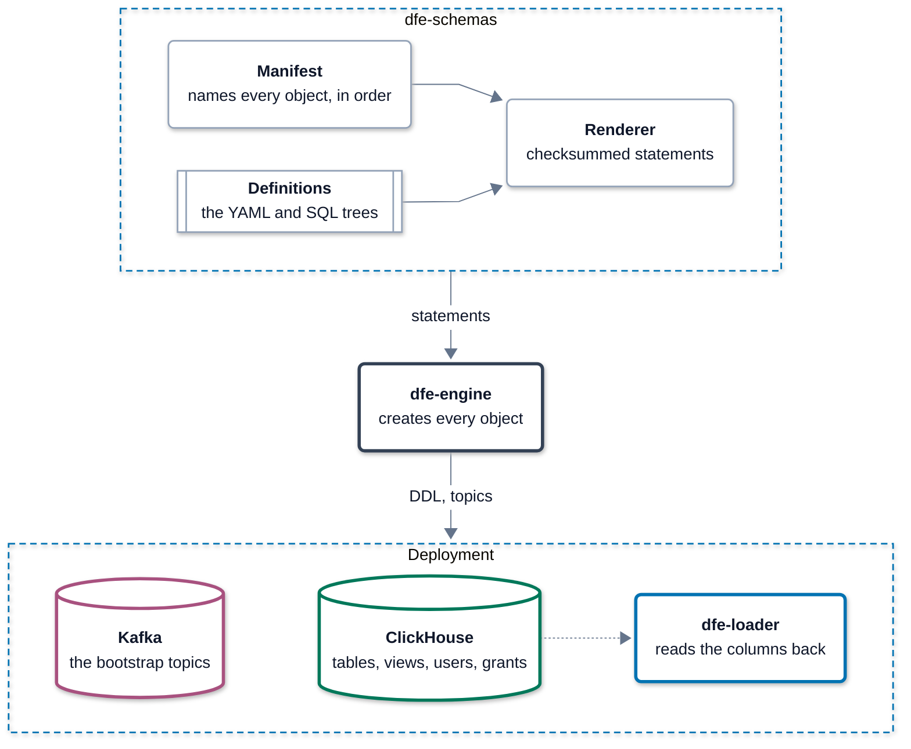

# dfe-schemas architecture

dfe-schemas defines every ClickHouse object and Kafka bootstrap topic a DFE deployment creates, and renders each one to the DDL that creates it. dfe-engine is the one thing that applies it, from the wheel it pins.

*Figure 1. L3 Components -- dfe-schemas. The dotted arrow is a read at runtime.* Up: top of dfe-schemas. Down: [L4 Detail -- Manifest](manifest.md), [L4 Detail -- Definitions](definitions.md), [L4 Detail -- Renderer](renderer.md).

## How data flows

1. A **Definition** describes one object: a table's columns in YAML, a view in SQL, a role or a topic.
2. The **Manifest** names every object a deployment creates, in the order it creates them, and which definition each one comes from.
3. The **Renderer** turns each manifest entry into statements for one ClickHouse platform, with a checksum that leaves the platform out.
4. **dfe-engine** reads the pinned wheel at boot, takes the schema lock, and compares each checksum with `dfe.schema_migrations` and the live server. It applies what is absent or additively changed and records the dfe-schemas version each object came from.
5. **dfe-loader** reads the deployed columns from ClickHouse's `system.columns`, never from this repo.

A change reaches a deployment only through an engine release. The engine image ships the wheel its `uv.lock` pins, and nothing reads this repository directly.

## Components

| Part | Role | Page |
|---|---|---|
| Manifest | `manifest.yaml`: every object a deployment creates, in dependency order | [manifest.md](manifest.md) |
| Definitions | The trees under `tables/`, `views/`, `roles/`, `topics/`, `common-header/`, `meta/`, `hunts/`, `dlq/` and `additional/` | [definitions.md](definitions.md) |
| Renderer | `dfe_schemas.render`: one object to statements for one platform, with a checksum | [renderer.md](renderer.md) |

## External dependencies

| Dependency | Needed for | Swappable |
|---|---|---|
| dfe-engine | The one applier. It declares `dfe-schemas` by range in its `pyproject.toml` | No |
| ClickHouse | Every table, view, user, role and grant | ClickHouse Cloud or self-hosted, detected by a probe |
| Kafka | The bootstrap topics | Any Kafka the engine reaches |
| `ruamel.yaml` | The package's one runtime dependency | No |

## Deployment variants

The same DDL goes to every profile, slim, single and scale, and to Kubernetes and Docker alike. What differs is the ClickHouse platform, and the probe works that out from the server.

- ClickHouse Cloud rewrites every `Replicated` engine to `SharedMergeTree`.
- Self-hosted on one node needs embedded Keeper, the `{cluster}`, `{shard}` and `{replica}` macros, and a cluster of one.
- Self-hosted on several nodes needs the same plus SQL users and roles in Keeper.

dfe-engine rejects a self-hosted server missing any of these at startup. [clickhouse-platform.md](clickhouse-platform.md) has the config.

## Design considerations

| Aspect | How it is handled |
|---|---|
| Security | Database, table, column and index names go through `quote_ident`, which rejects anything that could end a statement early. Roles and grants are definitions like any table, so access changes are reviewed in the same PR as the schema. |
| Reliability | Every statement converges: an `IF NOT EXISTS` creates and an `ALTER` re-asserts mutable state. A dependency declared later than its user is rejected, because that apply fails on a fresh cluster and succeeds on every re-run. |
| Operations | A published schema version is immutable. A change is a new version entry, so a pinned consumer keeps what it resolved. |
| Performance | Each column's use case picks its skip index from `registries/ddl.yaml`, and a TTL aligned with the partition key drops whole parts. |

## Why it's built this way

| Decision | Reason |
|---|---|
| One list, one applier | What a deployment creates is in one file. Adding a table is a manifest entry and a definition, never engine code, a Job or an init container. |
| `Replicated` engines everywhere | A literal plain engine is accepted on a cluster and lands on one replica, where every query succeeds and the answer depends on which node answered. So there is one engine form, and no plain fallback. |
| A package, not a submodule | The trees sit at the repo root so a checkout reads as itself, and the wheel has a copy as package data. `schemas_root()` picks whichever exists. |
| `ruamel.yaml`, not PyYAML | YAML 1.1 reads an unquoted `on` or `no` as a boolean and YAML 1.2 does not. dfe-engine reads the schema trees with the same parser, so both get one answer. Its `catalogue/` reader is PyYAML, so quote those words in a catalogue file. |
| Validation outside the main CI workflow | `make validate` borrows dfe-engine's loader for the `meta/` models. Running it from `ci.yml` would put dfe-engine in this repo's dependency graph, a cycle, so it runs from `validate-schemas.yml`. |

## Diagram map

- Figure 1. L3 Components -- dfe-schemas (this page)
  - [L4 Detail -- Manifest](manifest.md)
  - [L4 Detail -- Definitions](definitions.md)
    - [L4 Detail -- Meta schema to source table](meta-schema.md)
    - [L4 Detail -- Column composition](meta-schema.md#composition-pipeline)
  - [L4 Detail -- Renderer](renderer.md)

## What's next

- [ClickHouse platforms](clickhouse-platform.md): the probe and what a self-hosted server needs
- [Meta schema system](meta-schema.md): the column format reference
- [Compatibility profiles](compat-profiles.md), [Kafka topics](topics.md), [ClickHouse roles](roles.md)
- [CONTRIBUTING.md Context](../CONTRIBUTING.md#context): the code map, the invariants and the commands that test a change
