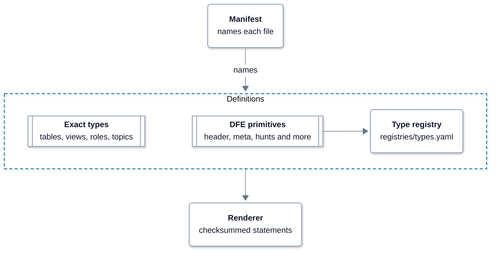

# Definitions

A definition describes one object a deployment creates, and the definition trees are one part of [dfe-schemas](architecture.md).

| Fact | Value |
|---|---|
| Repo | `hyperi-io/dfe-schemas`, the trees at the repo root |
| Package | the `dfe-schemas` wheel on PyPI, the trees as package data under `dfe_schemas/data/` |
| Config | `registries/types.yaml` maps DFE primitives to ClickHouse types. `DFE_ENGINE_SCHEMAS_DIR` points dfe-engine at another tree |
| Endpoints | none, they are files |
| Metrics | none |

Two families of definition exist, and which one a file belongs to decides how its column types resolve.

*Figure 1. L4 Detail -- Definitions.* Up: [L3 Components -- dfe-schemas](architecture.md). Down: [L4 Detail -- Meta schema to source table](meta-schema.md), [L4 Detail -- Column composition](meta-schema.md#composition-pipeline).

## How it works

1. `tables/**` is written in exact ClickHouse types, because those columns are engine state and telemetry with nothing to map from.
2. `common-header/**`, `meta/**`, `hunts/**`, `dlq/**` and `additional/**` use DFE primitives, and the **Type registry** maps each to a ClickHouse type.
3. Composition puts the header columns first, then what the composed definition adds. The header wins, so a source cannot redefine `_org_id`.
4. The **Manifest** names the file each object comes from, and the **Renderer** reads it.

A definition may drop header columns by name with `profile_exclude`. `hunts/results.yaml` drops `_raw` and `_tags`, because a detection references its source by `matched_uuid`. A second copy of the payload text, and an index over it, earn nothing.

## Interfaces

| Form | Meaning |
|---|---|
| `ch_type` | An exact ClickHouse type. It bypasses the primitive mapping and resolves NOT NULL, which is what a sorting key needs |
| `type` | A DFE primitive, mapped through `registries/types.yaml` |
| Version tree | Each version entry is a complete column snapshot, not a delta. `current` names the default |
| Flat list | A column list with no versions |

A file mixing `ch_type` and `type` is rejected rather than half-read.

Versions follow SchemaVer: model, addition, revision. A published version is immutable, because consumers pin versions independently and an in-place edit changes what a pinned consumer resolves.

## Scaling and failure

A definition that will not render on some platform fails `make render`. So does a Nullable `ORDER BY` key, a TTL over an absent column, and a view placeholder with no value. The full list is in [CONTRIBUTING.md Context](../CONTRIBUTING.md#context).

## Related

- [Meta schema system](meta-schema.md), the column format reference
- [Table definitions](tables.md), [Registries](registries.md), [Kafka topics](topics.md), [ClickHouse roles](roles.md)
- [Manifest](manifest.md), [Renderer](renderer.md)
