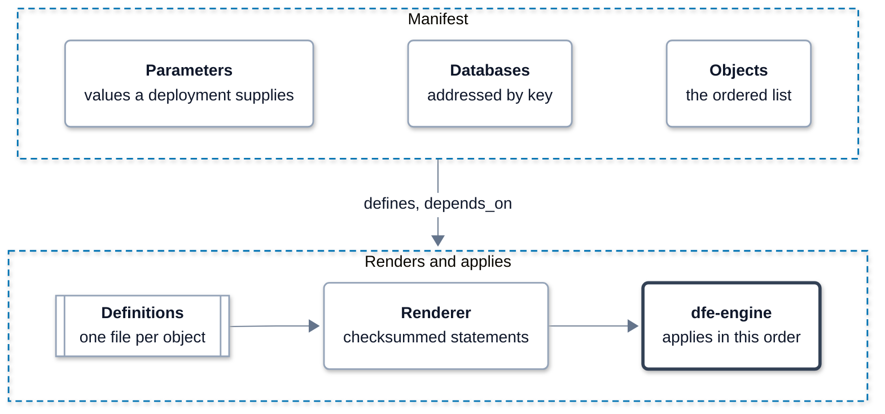

# Manifest

`manifest.yaml` names every object a DFE deployment creates, in the order it creates them, and is one part of [dfe-schemas](architecture.md).

| Fact | Value |
|---|---|
| Repo | `hyperi-io/dfe-schemas`, file `manifest.yaml` |
| Package | the `dfe-schemas` wheel on PyPI, read by `dfe_schemas.manifest.load_manifest` |
| Config | the `parameters` block, each value supplied by a dfe-engine setting |
| Endpoints | none, it is a file |
| Metrics | none. `make render` prints the objects it rendered, by kind |

dfe-engine applies nothing that is not in the manifest, in the order it lists.

*Figure 1. L4 Detail -- Manifest.* Up: [L3 Components -- dfe-schemas](architecture.md). Down: none.

## How it works

1. dfe-engine loads the manifest at boot and applies nothing that is not in it.
2. Each object's `defines` names its definition file, and its `database` names a declared key.
3. The renderer substitutes the parameters and renders the objects in list order.
4. dfe-engine applies them in that order, so a `depends_on` always names something already created.

## Interfaces

The top-level keys:

| Key | Meaning |
|---|---|
| `manifest_version` | The format this file is written in. The reader rejects a version it does not know rather than guessing at the fields. |
| `parameters` | The deployment values the renderer substitutes: the data database, the default retention, Kafka tiered storage. Each names the setting that supplies it. The ClickHouse platform is not one of them: it is probed from the server. |
| `databases` | The databases objects land in, by KEY. A key has either `parameter` (the deployment supplies the name) or `name` (fixed). |
| `objects` | The list. |

A database is addressed by key rather than by name because a deployment can rename its data database. A literal would create the object, grant on it and query it in a database that deployment does not have.

Each entry under `objects` takes these keys:

| Key | Meaning |
|---|---|
| `id` | Unique across the manifest. Two definitions claiming one name means whichever applies second wins, so this is checked. |
| `kind` | `database`, `table`, `materialized_view`, `view`, `role` or `topic`. |
| `database` | The declared database key. A topic names none. |
| `defines` | The definition file, relative to the schemas root, without a suffix. `.yaml` for everything but a view, which is `.sql`. |
| `section` / `key` | Where inside `defines` the entry is, for the files that hold several: a role's section in `roles/clickhouse.yaml`, a topic's section in `topics/kafka.yaml`, a materialised view's name in a table file's `materialized_views`. |
| `header` | The common-header profile to compose, for a table with columns from one. |
| `compose` | A second definition composed over the header (or used alone), such as `hunts/results` for the detection table. |
| `topology` | `resolved` for an object with DDL that differs by ClickHouse platform, `fixed` for one that is the same everywhere. ClickHouse access objects and Kafka topics are `fixed`. The reader checks the value, and nothing renders by it: the platform comes from the renderer's caller. |
| `additive` | Whether an additive change may be applied automatically. A changed type, ORDER BY, PARTITION BY, TTL or codec is drift either way and is rejected. |
| `optional` | The apply may skip this object without failing the pass. |
| `depends_on` | Ids declared EARLIER in the list. |

Row policies are not manifest objects. dfe-engine's reconciler writes a RESTRICTIVE policy on every table that has `_org_id`, read off the live server, and a `USING 0` one on each tenant-reachable table that does not. It takes the policy name from `naming.row_policy` and the tenant setting from `tenant.setting` in `roles/clickhouse.yaml`. The predicate is the engine's: nothing reads the catalogue's `tenant.predicate`.

Per-source tables are not manifest objects either. The manifest is the set a deployment creates before anything streams. A source's table is created when that source is deployed, through the same table renderer.

## Scaling and failure

`depends_on` is checked against what precedes it, not against everything that exists. A view over a table declared after it is an apply that fails on a fresh cluster and succeeds on every re-run afterwards, so it breaks for whoever stands one up and nobody else.

`make render` (`scripts/render_manifest.py`) renders every object for both ClickHouse platforms and fails on:

* a duplicate `id`, or a `depends_on` that is unknown or declared later
* two objects rendering to the same qualified name
* a definition that will not render on some platform, such as a refreshable materialised view with a `refresh` that is not an `EVERY` or `AFTER` schedule
* a table that stores rows with an engine that is not `Replicated*`, or one that writes a Keeper path and replica into its engine
* a statement other than the self-hosted CREATE DATABASE that has `ON CLUSTER`
* a statement naming a `<database>.<object>` the manifest does not declare
* a checksum that differs between platforms

The checksum and the one engine form are on the [Renderer](renderer.md) page.

## Related

* [Definitions](definitions.md), [Renderer](renderer.md), [ClickHouse platforms](clickhouse-platform.md)
