# Meta schema system

A meta schema is a YAML file that defines the columns for a ClickHouse table: what the table should look like. dfe-engine reads it, generates DDL and applies it to ClickHouse. This page is the format reference. The engine classes that consume it are documented in the dfe-engine repo (`docs/data-plane/schema-classes.md`).

At runtime dfe-loader reads the deployed columns from ClickHouse, never the YAML.


*Figure 1. L4 Detail -- Meta schema to source table. The dotted arrow is dfe-loader reading `system.columns` at runtime.* Up: [L3 Components -- dfe-schemas](architecture.md).

The YAML is what the schema should be, and the ClickHouse table is what it is. At runtime the deployed table is the authority.

## Where meta schemas live

Meta schemas are YAML files at the root of this repo, shipped to consumers as the pinned `dfe-schemas` PyPI wheel. Common header profiles, hunt result schemas and source schemas all use the same format.

```text
dfe-schemas/                      <- repo root, shipped as a PyPI wheel
|-- common-header/
|   |-- timeseries.yaml           <- the default profile
|   |-- minimal.yaml              <- the high-volume profile
|   '-- passthrough.yaml          <- the transparent bridge
|-- compat-profiles/              <- rule rows that read another platform's header (compat-profiles.md)
|-- meta/                         <- source meta schemas, one directory per provider, plus syslog.yaml
|-- additional/                   <- extra-field overlays (<package>/<data_stream>, snapshot/)
|-- derived/                      <- derived schemas: a select list over a base
|-- dlq/entry.yaml                <- the dead-letter columns composed onto the header
'-- hunts/
    |-- results.yaml              <- hunt detection output columns
    '-- detection_checkpoint.yaml <- runner checkpoint table
```

## YAML format

A meta schema is a version tree, or a flat column list for a file with no versions.

Each version holds a complete column snapshot. Read `versions."1.0.0".columns` and you have the full schema for that version, with nothing to filter or reconstruct.

```yaml
current: "1.0.0"                      # Default version when no pin specified

versions:
  "1.0.0":
    date: "2026-01-15"
    type: model                       # model | addition | revision
    summary: "Initial schema"
    columns:
      - name: user_name
        type: string
        use_case: dimension
        expr: "@source: first(user_id/uid/id)"
        comment: "User identifier"

      - name: source_ip
        type: ip
        use_case: range
        expr: "@source: src_ip"
        comment: "Source IP address"

      - name: message
        type: text
        use_case: word_search
        comment: "Log message body"
```

A file without `current` and `versions` is a plain column list with no versioning:

```yaml
columns:
  - name: user_name
    type: string
    use_case: dimension
  - name: message
    type: text
    use_case: word_search
```

| Field | Required | Description |
|-------|----------|-------------|
| `current` | Yes | Default version when a consumer names no pin |
| `versions` | Yes | Version string to version entry |
| `date` | Yes, per version | When the version was created (YYYY-MM-DD) |
| `type` | Yes, per version | Change category: `model`, `addition`, `revision` |
| `summary` | Yes, per version | What changed, for a person |
| `columns` | Yes, per version | Complete column snapshot for this version |
| `profile_exclude` | No, per version | Common-header columns to drop when this schema is composed onto a profile |

`profile_exclude` trims the header for a table that does not need all of it. `hunts/results.yaml` uses it to drop `_raw` and `_tags`: a detection row references its source by `matched_uuid`, so a second copy of the payload text plus an ngram index over it is storage for nothing. Naming a column the profile does not have is a no-op, not an error, because a profile can lack it (`minimal` has no `_raw`).

## Column definition reference

Each column is a `SchemaColumn`. `name` and `type` are required, and the rest are optional.

```yaml
columns:
  - name: _org_id                    # column name
    type: string                     # primitive type
    cardinality: low                 # low | high | unknown
    use_case: dimension              # query pattern -> index
    attribute: [not_null]            # storage modifiers
    default: null                    # DEFAULT expression
    order: 2                         # ORDER BY position
    expr: "@source: _org_id"         # DFE loader directive
    comment: "Tenant identifier"     # human description
    ch_override: null                # exact ClickHouse type
```

| Field | Type | Default | Description |
|-------|------|---------|-------------|
| `name` | `str` | *(required)* | Column name. System fields take a `_` prefix to avoid collision with source data. |
| `type` | `str` | *(required)* | Primitive type, one of the primitives in `registries/types.yaml` (see [Type system](#type-system)). |
| `cardinality` | `str` | `unknown` | How many distinct values the column holds: `low`, `high` or `unknown` (see [Cardinality](#cardinality)). |
| `attribute` | `list[str]` | `[]` | Storage attributes: `nullable`, `not_null`, `materialized`, `alias`, and the retired `lowcardinality`. Takes a single string or a list. |
| `use_case` | `str \| null` | `null` | The question the column is asked, which picks its index: `dimension`, `exact_match`, `range`, `word_search`, `substring_search`, `key_search`, `similarity_search(<dims>)`. |
| `default` | `str \| null` | `null` | Raw ClickHouse DEFAULT expression (`"now64(3)"`, `"generateUUIDv7()"`). The MATERIALIZED or ALIAS expression when one of those attributes is set. |
| `order` | `int \| null` | `null` | Position in ORDER BY and PRIMARY KEY, from 0. A column without one is left out of the key. |
| `expr` | `str \| null` | `null` | DFE directive that tells the loader how to fill this column (see [DFE expressions](#dfe-expressions)). |
| `comment` | `str \| null` | `null` | Description for a person. |
| `ch_override` | `str \| null` | `null` | Exact ClickHouse type string, in place of the primitive mapping. |
| `codec` | `str \| null` | `null` | CODEC arguments, emitted verbatim in place of the primitive's codec. The one way to give a `ch_override` column one. |
| `_field_type` | `str \| null` | `null` | Column classification (`base` = shipped by DFE). Maps to the engine model's `field_type`. |
| `max_dynamic_paths` | `int \| null` | `null` | JSON-column dynamic-path budget. Rendered as `JSON(max_dynamic_paths=N)` on a bare `JSON` column, and ignored on any other type. |
| `synthetic` | `map \| null` | `null` | Synthetic data hints (see [Synthetic data hints](#synthetic-data-hints)). The schema loader and DDL generation ignore it. |

A column in a dfe-schemas file takes no `index`: the loader rejects one, and `use_case` picks the index. dfe-engine takes an `index` on a source's columns, an exact index TYPE and GRANULARITY that wins over `use_case`.

### Synthetic data hints

dfe-engine's synthetic data generator reads an optional `synthetic:` mapping on a column when it produces data from this schema: a continuous inbound stream for demos, and repeatable data for testing. The schema loader ignores the key, so hints never affect validation or DDL. Hints apply in priority order -- `static`, `values`, `templates`, `provider`, then `minimum` and `maximum` -- and a column without hints falls back to the engine's heuristics on its name and type.

| Hint | Type | Description |
|------|------|-------------|
| `static` | any | Emit this exact value for every event. |
| `values` | `list` | Categorical vocabulary to draw from. |
| `weights` | `list[float]` | Draw weights aligned with `values`. |
| `templates` | `list[str]` | Message templates with `{placeholder}` tokens filled from the event's entity context (`{username}`, `{ipv4}`, `{external_ipv4}`, `{port}`, `{http_status}`, ...). |
| `provider` | `str` | Faker provider method to call (`user_agent`). |
| `minimum` / `maximum` | number | Bounds for numeric generation. |
| `format` | `str` | Timestamp rendering: `iso8601` (default), `epoch_s`, `epoch_ms`, or a strftime pattern. |

Correlated columns must not draw independently: an sshd message under `appname: cron` reads as fake. A version entry may have a `synthetic:` mapping BESIDE `columns:`, with a `scenarios:` list that defines coherent events. One weighted scenario is drawn per event, and its `values` and `templates` override per-column hints for the columns it names:

```yaml
versions:
  "1.0.0":
    columns: [...]
    synthetic:
      scenarios:
        - name: sshd-auth
          weight: 35
          values:
            app_name: sshd
            facility: [auth, authpriv]     # list draws uniformly
            severity: [info, info, notice] # repeat entries to weight
          templates:
            message:
              - "Failed password for {username} from {external_ipv4} port {port} ssh2"
```

A column a scenario does not name falls back to its hints, then the heuristics. `meta/syslog.yaml`, `meta/otel/logs.yaml` and `meta/beats/filebeat.yaml` use scenarios for the correlated columns and hints for the rest.

### How `expr` and `comment` become DDL

In the generated DDL, `expr` and `comment` are joined into one ClickHouse COMMENT clause, directive first. The loader parses the `@` directives it acts on from the COMMENT at runtime (see [DFE expressions](#dfe-expressions) for which ones):

```sql
-- Both expr and comment:
`_timestamp` DateTime64(3,'UTC') COMMENT '@source: timestamp | now() - Event timestamp'

-- Expr only (descriptive -- the DEFAULT clause is what the loader reads):
`_uuid` UUID DEFAULT generateUUIDv7() COMMENT '@generated: generateUUIDv7()'

-- Comment only:
`matched_uuid` UUID COMMENT 'UUID of the matching source record'
```

## Type system

Primitives are type names that map to ClickHouse types with their codec and nullability. Pick the primitive that describes the data, and `registries/types.yaml` supplies the rest:

| Primitive | What it is | ClickHouse type | Codec | Nullable default |
|-----------|-----------|-----------------|-------|-----------------|
| `string` | Short-to-medium text (names, IDs, codes) | `String` | `ZSTD(1)` | Yes |
| `text` | Large text (log messages, bodies) | `String` | `ZSTD(3)` | Yes |
| `integer` | Whole number (counts, IDs, event codes) | `Int64` | `ZSTD(1)` | Yes |
| `float` | Decimal number (scores, latency) | `Float64` | `ZSTD(1)` | Yes |
| `boolean` | True/false | `Bool` | `LZ4` | **No** |
| `datetime` | Date and time with timezone | `DateTime64(3,'UTC')` | `Delta, ZSTD(1)` | Yes |
| `timestamp` | Date and time, not nullable by default (for ORDER BY) | `DateTime64(3,'UTC')` | `Delta, LZ4` | **No** |
| `date` | Date, no time | `Date` | `Delta, ZSTD(1)` | Yes |
| `ip` | IP address (v4 or v6) | `IPv6` | `LZ4` | Yes |
| `uuid` | Unique identifier | `UUID` | *(none)* | Yes |
| `json` | Structured or semi-structured data | `JSON` | `ZSTD(3)` | Yes |
| `geo_point` | Latitude/longitude pair | `Point` | `ZSTD(1)` | Yes |
| `enum` | Fixed set of allowed values | `Enum8(...)` | `ZSTD(1)` | **No** |
| `map` | String-keyed attributes (labels, tags) | `Map(LowCardinality(String), String)` | `ZSTD(1)` | **No** |
| `vector` | Embedding for similarity search | `Array(Float32)` | `ZSTD(1)` | **No** |

ClickHouse rejects `Map` and `Array` inside `Nullable`, so neither of the last two can be null.

Nullable comes from the primitive's default and the `nullable` and `not_null` attributes. LowCardinality comes from `cardinality` and nothing else. Nullable wraps the type, and LowCardinality wraps that:

| Declared | Resolves to |
|----------|-------------|
| `string` | `Nullable(String)` |
| `string`, `cardinality: low` | `LowCardinality(Nullable(String))` |
| `string`, `cardinality: low`, `[not_null]` | `LowCardinality(String)` |
| `string`, `cardinality: high` | `Nullable(String)` |
| `timestamp` | `DateTime64(3,'UTC')`, not nullable by default |
| `boolean` | `Bool`, not nullable by default |

### ClickHouse type override (`ch_override`)

When a primitive does not fit, name the exact ClickHouse type:

```yaml
  - name: http_status
    type: integer
    ch_override: UInt16
    use_case: dimension

  - name: precision_ts
    type: datetime
    ch_override: "DateTime64(6,'UTC')"

  - name: nested_data
    type: string
    ch_override: "Nested(key String, value String)"
```

When `ch_override` is set:

- The column is NOT NULL whatever the primitive's default, unless it has the `nullable` attribute
- It takes no codec but one it declares in `codec`
- `cardinality: low` still wraps it in `LowCardinality(...)`, and `max_dynamic_paths` still applies to a bare `JSON`

dfe-engine validates `ch_override` against the `ch_overrides` list in `registries/types.yaml`: integers, floats, decimals, strings, dates, geo, complex types, enums and the specials.

## Cardinality

Cardinality is how many distinct values the column holds. It is one declaration because it decides two things that must agree: the storage wrapper, and whether `exact_match` picks `set(0)` or `bloom_filter`.

| Value | Storage | `exact_match` index |
|-------|---------|---------------------|
| `low` | `LowCardinality(...)` | `set(0)`, which holds every distinct value exactly |
| `high` | plain | `bloom_filter`, bounded and probabilistic |
| `unknown` *(default)* | plain | `bloom_filter` |

`unknown` is the honest default. Nobody re-reviews a field that looks decided, so a column nobody has counted says so, and gets the safe way to be wrong: no dictionary, and an index with a cost that does not grow with the column.

Measure it rather than guess it. An Elasticsearch index template has no cardinality, so dfe-engine's template importer leaves an imported column `unknown`, and so is every column of `meta/elastic/ecs.yaml`. The importer's one exception is a `constant_keyword`, which it reads as `low` because it holds one value.

A default ClickHouse creates `LowCardinality` over `String`, `FixedString` and `UUID` alone, and rejects the rest with code 455. So `cardinality: low` belongs on a `string` or `text` column.

`attribute: [lowcardinality]` is the retired spelling and still reads as `cardinality: low`. Declaring the two against each other is rejected.

## Attributes

Attributes change how the type is stored, given as a list in YAML.

| Attribute | What it does | Valid primitives |
|-----------|-------------|-----------------|
| `lowcardinality` | Retired, the old spelling of `cardinality: low` | `string`, `text` |
| `nullable` | Allows NULL, over the primitive's default | all |
| `not_null` | Forces NOT NULL, over the primitive's default | all |
| `materialized` | Column computed on INSERT, not stored in source data | all |
| `alias` | Virtual column computed at query time | all |

The list is `attributes.<name>.valid_primitives` in `registries/types.yaml`, which dfe-engine validates a column against.

The `default` field renders a different clause with each attribute:

| Attributes | DDL clause |
|-----------|-----------|
| *(none)* | `DEFAULT {default}` |
| `[materialized]` | `MATERIALIZED {default}` |
| `[alias]` | `ALIAS {default}` |

```yaml
# Materialized: computed on insert from other columns
  - name: day
    type: date
    attribute: [materialized]
    default: "toDate(_timestamp)"

# Alias: virtual, computed at query time
  - name: year
    type: integer
    attribute: [alias]
    default: "toYear(_timestamp)"
```

`string`, `text`, `integer`, `float`, `datetime`, `date`, `ip`, `uuid`, `json` and `geo_point` are Nullable by default. `timestamp`, `boolean`, `enum`, `map` and `vector` are NOT NULL by default. `nullable` or `not_null` overrides either.

A `Nullable(T)` column stores a separate null map beside its data, which costs storage and read speed. A Nullable sort key needs `allow_nullable_key`, so the manifest renderer rejects one and dfe-engine drops it from a source table's key with a warning. `timestamp`, the primitive meant for a sort key, is not nullable by default.

## Use cases

A use case names the question you ask the column, never the ClickHouse index that answers it. You declare the question, the DDL catalogue picks the index, and a later ClickHouse can get a different index without your schema changing.

| Use case | The question | Example columns |
|----------|------------|-----------------|
| `dimension` | I filter and group by this: `WHERE status = 'error'` | status, severity, org_id |
| `exact_match` | I look up specific values | trace_id, request_id |
| `range` | I query ranges, between, time windows: `WHERE latency > 100` | latency_ms, timestamp |
| `word_search` | I search for whole words: `WHERE hasToken(message, 'error')` | message, log_body |
| `substring_search` | I search for fragments inside words: `WHERE message LIKE '%refused%'` | syslog_message |
| `key_search` | I search the keys and values of a map column | attributes, labels |
| `similarity_search(<dims>)` | I find records similar to this one | embedding |
| *(empty)* | No index | raw payload, metadata |

`similarity_search` is the one use case that takes an argument: ClickHouse needs the vector's dimension count up front and cannot read it off the column.

| Use case | Valid primitives |
|----------|-----------------|
| `dimension` | `string`, `integer`, `boolean`, `enum`, `ip`, `uuid` |
| `exact_match` | `string`, `uuid`, `integer`, `ip` |
| `range` | `integer`, `float`, `datetime`, `timestamp`, `date`, `ip` |
| `word_search` | `string`, `text` |
| `substring_search` | `string`, `text` |
| `key_search` | `map` |
| `similarity_search` | `vector` |

An invalid combination, such as `word_search` on an `integer`, is rejected at validation time.

### Generated ClickHouse indexes

Each use case renders the index below on the ClickHouse the stack pins. Read them to size the cost, not to name a column. They live as data in `registries/ddl.yaml`, the DDL catalogue, read through `dfe_schemas.ddl_catalogue`, so a changed answer is a catalogue edit and a dfe-schemas release, not a code change.

| Use case | Index type | Granularity | Notes |
|----------|-----------|-------------|-------|
| `dimension` | `set(0)`, or `bloom_filter` on a Nullable column | 4 | `set(0)` holds the exact distinct values per granule, but prunes nothing on a Nullable column on 26.3 |
| `exact_match` | `set(0)` on `cardinality: low` when not Nullable, else `bloom_filter` | 4 | The bloom filter is probabilistic: false positives, no false negatives. It takes `IPv6`, and on an `Array` column it answers `has()`, `hasAny()` and `hasAll()` |
| `range` | `minmax` | 4 | Stores min and max per granule |
| `word_search` | `text(tokenizer=splitByNonAlpha)` | 1 | Text index (26.2 and later), row-level filtering |
| `substring_search` | `text(tokenizer=ngrams(3))` | 1 | Character n-gram text index for substring matching |
| `key_search` | two indexes, `text(tokenizer=array)` over `mapKeys(col)` and `mapValues(col)` | 1 | A text index rejects a `Map` column itself, so the keys and the values are indexed apart |
| `similarity_search(<dims>)` | `vector_similarity('hnsw', 'cosineDistance', <dims>)` | 100000000 | One index per part: at granularity 1 each granule gets a separate graph and the top-k comes back wrong. `hnsw` is the one method 26.3 implements |

The catalogue holds one answer per use case. `tokenbf_v1` and `ngrambf_v1` are not among them: the ClickHouse DFE ships deprecates both in favour of the text index.

| You look for | Declare | Query it as |
|--------------|---------|-------------|
| One id, hash or user among millions | `exact_match` on a `string` or `uuid` | `col = 'x'`, `col IN (...)` |
| One IP address | `exact_match` on an `ip` | `src_ip = toIPv6('10.1.2.3')` |
| A value inside an array column | `exact_match` on the element's primitive, with `ch_override: Array(...)` | `has(col, 'x')`, `hasAny`, `hasAll` |
| A numeric id or event code with many values | `exact_match` on an `integer` | `col = 4624` |
| A handful of values, filtered and grouped | `dimension`, with `cardinality: low` | `col = 'error'`, `GROUP BY col` |
| A time window, a numeric range, an address range | `range` | `col > 100`, `ip BETWEEN toIPv6('10.0.0.0') AND toIPv6('10.255.255.255')` |
| A whole word in free text | `word_search` | `hasToken(col, 'refused')`, `hasAnyTokens`, `hasAllTokens` |
| A fragment of at least 3 characters | `substring_search` | `col LIKE '%efuse%'` |
| A key or value in a map | `key_search` | `mapContainsKey(col, 'k')`, `has(mapValues(col), 'v')` |
| The nearest embeddings | `similarity_search(<dims>)` | `ORDER BY cosineDistance(col, [...]) LIMIT 10` |

A vector search with a narrow `WHERE` can return fewer than the `LIMIT`: ClickHouse takes the index's k nearest, then filters them.

An address range is a `BETWEEN` on the two ends. `isIPAddressInRange()` reads every row, because no index can prune it.

`exact_match` on an `integer` or an `ip` is a bloom filter. `range` stores min and max per granule, which prunes when the values arrive roughly in order. A lookup on one address in unsorted traffic needs `exact_match`.

## DFE expressions

The `expr` field holds directives, emitted as ClickHouse column comments. The Rust loader reads them back from `system.columns` at runtime and parses the six names in `DIRECTIVE_NAMES` (dfe-loader `src/column_meta/mod.rs`): `@skip`, `@default`, `@source`, `@renamed`, `@computed` and `@coerce`. `@generated` and `@config` are not among them, so the loader drops both as unknown directives.

| Directive | Purpose | Example | Loader-parsed |
|-----------|---------|---------|----------------|
| `@source: field` | Copy from source data | `@source: timestamp \| now()` | Yes |
| `@source: first(a/b/c)` | First non-null from list | `@source: first(user_id/uid/id)` | Yes |
| `@renamed: field` | Zero-copy field rename | `@renamed: logoriginal` | Yes |
| `@computed: expr` | Derived or enriched value | `@computed: geoip(ip).country_code` | Yes |
| `@default: value` | Substitute when the column is null or absent | `@default: unknown` | Yes |
| `@skip` | Leave the column out of the insert | `@skip` | Yes |
| `@coerce: category` | Override the type category for coercion | `@coerce: IPv4` | Parsed, then ignored with a warning: no encoder reads it |
| `@generated: expr` | Descriptive: ClickHouse generates via DEFAULT | `@generated: now64(3)` | No |
| `@config: path` | Descriptive: mapping is configurable | `@config: routing.org_id_field` | No |

`@generated` describes a DEFAULT, MATERIALIZED or ALIAS clause the column's `default:` and `attribute:` fields declare. The loader omits the field because it reads that clause's kind from `system.columns` (`default_kind`), not because it parsed the `@generated:` text. `@config` records that another field's value comes from loader config (`routing.org_id_field`) rather than a fixed name, and the loader never reads the comment's path to resolve it. dfe-loader's `docs/clickhouse/ddl-directives.md` has the full mechanism: <https://github.com/hyperi-io/dfe-loader/blob/main/docs/clickhouse/ddl-directives.md>.

In the header profiles `_raw` and `_json` have no directive: what they hold depends on the loader's capture mode. A `@source` on `_json` makes the loader read that field instead, as the dead-letter table's does.

dfe-loader's config beats a column comment. A `column_directives` entry overrides the directive on that column, and `_org_id` is filled from `routing.org_id_field` alone, never from a directive.

## Common header profiles

A source table starts with a header of underscore-prefixed system fields from a profile, the deployment's default profile when it names none, and so do the landing, dead-letter and detection tables. The profile decides which header columns are included.

| Profile | Columns | Use case |
|---------|---------|----------|
| `timeseries` (default) | 9 | Logs, alerts, audit trails: full event ingestion |
| `minimal` | 5 | Metrics, flow records: high-volume structured data |
| `passthrough` | 4 | Transparent bridge with no timestamp injection |

`timeseries`, the default:

| Column | Type | Cardinality | Use case | ORDER BY | Expr |
|--------|------|-------------|----------|----------|------|
| `_timestamp_load` | `timestamp` | | | 0 | `@generated: now64(3)` |
| `_timestamp` | `timestamp` | | `range` | 1 | `@source: timestamp \| now()` |
| `_timestamp_received` | `timestamp` | | | | `@source: first(_timestamp_received/timestamp_received/received_at)` |
| `_uuid` | `uuid` | | | | `@generated: generateUUIDv7()` |
| `_org_id` | `string` | `low` | `dimension` | 2 | `@source: _org_id` |
| `_source` | `string` | `low` | `dimension` | | `@source: first(_source) \| topic_name` |
| `_raw` | `text` | | `substring_search` | | capture mode |
| `_json` | `json` | | | | capture mode |
| `_tags` | `json` | | | | `@source: first(_tags/tags/meta/metadata.tags)` |

Each header field reads its `_`-prefixed wire name first, except the event timestamp. The header expects the first hop, dfe-receiver or dfe-fetcher, to stamp `_org_id` and `_timestamp_received` on every record. dfe-loader fills `_org_id` from its `routing.org_id_field`, `_org_id` by default, and never from the column's directive, which records the field rather than choosing it. A sender's spelling of the tenant, such as a DFE 2.x `org_id`, reaches `_org_id` through a [compatibility profile](compat-profiles.md) at the first hop and no other way.

`minimal` has `_timestamp_load`, `_timestamp`, `_uuid`, `_org_id` and `_json`. `passthrough` has `_timestamp_load`, `_uuid`, `_org_id` and `_json`.

A source names its profile and pins a version:

```yaml
# In the Source YAML:
header:
  type: timeseries          # Profile name
  version: "1.0.0"          # Pin to specific profile version
```

Profile columns come first and source columns follow. A source column that repeats a profile column's name is dropped with a warning, and the profile's column is kept.

## Composition pipeline

A composed schema is built from up to four layers: the header profile, then the meta schema, narrowed by a derived schema and extended by additional fields.

```mermaid
---
config:
  theme: base
  look: neo
  fontFamily: Inter, -apple-system, Segoe UI, Roboto, Helvetica, Arial, sans-serif
  flowchart:
    curve: linear
    nodeSpacing: 40
    rankSpacing: 64
    padding: 18
    wrappingWidth: 280
    htmlLabels: true
  elk:
    preset: modelOrder
  themeVariables:
    fontSize: 15px
    lineColor: "#64748B"
    primaryTextColor: "#0F172A"
    clusterBorder: "#0072B2"
    edgeLabelBackground: "#FFFFFF"
  themeCSS: >-
    p{margin:0}
    .node[data-look] rect,.node[data-look] path,.node[data-look] polygon,.node[data-look] .outer-path{filter:drop-shadow(0 1px 2px rgba(15,23,42,.10)) drop-shadow(0 6px 14px rgba(15,23,42,.10))}
    .node rect{rx:10px;ry:10px}
    .cluster rect{rx:16px;ry:16px}
    .node .label div{min-width:150px}
    .node.decision .label div{min-width:0}
    .cluster[data-look] rect{filter:none}
    .nodeLabel{line-height:1.35}
    .nodeLabel b{font-weight:600;font-size:15px;letter-spacing:-0.01em}
    .nodeLabel span{font-size:12.5px;font-weight:400;color:#334155}
    .cluster-label span.nodeLabel{display:inline-block;background:#FFFFFF;color:#0B2A3F;border:1.5px solid #0072B2;border-radius:999px;padding:2px 12px;font-size:11.5px;font-weight:700;letter-spacing:.09em;text-transform:uppercase}
    .flowchart-link{stroke-width:1.75px}
    .labelBkg{background:transparent!important}
    span.edgeLabel{display:inline-block;background:#FFFFFF!important;color:#1E293B;border:1px solid #94A3B8;border-radius:999px;padding:2px 10px;font-size:12px;font-weight:500}
    span.edgeLabel p{background:transparent!important}
    .label-icon{width:20px;height:20px;vertical-align:-4px;margin-right:6px}
    .ingest .label-icon{color:#0E8A7D}
    .xform .label-icon{color:#7B4FB0}
    .load .label-icon{color:#0072B2}
    .bus .label-icon{color:#A8517F}
    .store .label-icon{color:#00785A}
    .ui .label-icon{color:#D9480F}
    .ext .label-icon{color:#64748B}
---
flowchart LR
  accTitle: L4 Detail -- Column composition
  accDescr: The source columns start from the meta schema, an optional derived schema narrows them and optional additional fields extend them. Compose puts the header profile's columns first and the source columns after, which gives the table's ordered column list.
  profile("<b>Header profile</b><br/><span>always first</span>")
  subgraph source["Source columns"]
    direction LR
    meta("<b>Meta schema</b><br/><span>the base columns</span>")
    derived("<b>Derived schema</b><br/><span>narrows to its select list</span>")
    additional("<b>Additional fields</b><br/><span>adds the columns the base lacks</span>")
    meta -.-> derived -.-> additional
  end
  compose("<b>Compose</b><br/><span>profile first, source after</span>")
  columns(["<b>Table columns</b><br/><span>the ordered list</span>"])
  profile -->|first| compose
  source -->|after| compose
  compose -->|ordered| columns
  classDef ext fill:#F4F6F8,stroke:#94A3B8,stroke-width:1.5px,stroke-dasharray:5 4,color:#0F172A
  classDef ingest fill:#FFFFFF,stroke:#0E8A7D,stroke-width:3px,color:#0F172A
  classDef xform fill:#FFFFFF,stroke:#7B4FB0,stroke-width:3px,color:#0F172A
  classDef load fill:#FFFFFF,stroke:#0072B2,stroke-width:3px,color:#0F172A
  classDef bus fill:#FFFFFF,stroke:#A8517F,stroke-width:3px,color:#0F172A
  classDef store fill:#FFFFFF,stroke:#00785A,stroke-width:3px,color:#0F172A
  classDef ui fill:#FFFFFF,stroke:#D9480F,stroke-width:3px,color:#0F172A
  classDef decision fill:#FFFFFF,stroke:#9A6700,stroke-width:3px,color:#0F172A
  classDef error fill:#FFFFFF,stroke:#C2410C,stroke-width:3px,color:#0F172A
  classDef control fill:#FFFFFF,stroke:#334155,stroke-width:3px,color:#0F172A
  classDef part fill:#FFFFFF,stroke:#94A3B8,stroke-width:1.5px,color:#0F172A
  class profile,meta,derived,additional store
  class compose,columns part
```



*Figure 2. L4 Detail -- Column composition. Dotted arrows lead to the optional layers.* Up: [L3 Components -- dfe-schemas](architecture.md).

dfe-engine's `SchemaLoader` runs each layer: `load_profile` for the header, `load_columns` for the meta schema, `apply_derived_schema` and `apply_additional_fields` for the optional two, then `compose`.

| Layer | Merge behaviour |
|-------|----------------|
| Profile | Always first. A source column cannot override a profile column. |
| Meta schema | The source's base columns. |
| Derived schema | Narrows the source columns to its `select` list, in that order. A selected column may override `index` and nothing else, and a name the base lacks is an error. |
| Additional fields | Appends the columns the base lacks. A column with a name the base has replaces that base column. |

A source wires the layers in its schema block:

```yaml
source: windows_audit
header:
  type: timeseries
  version: "1.0.0"
schema:
  meta_schema: meta/windows_audit.yaml        # Layer 2: base columns
  meta_schema_version: "2.1.0"                # Pin meta schema version
  derived_schema: derived/windows_custom.yaml  # Layer 3: narrows to a select list
  additional_fields: additional/windows_extra.yaml  # Layer 4: extra columns
  ttl_days: 90
  engine: MergeTree
```

Schema file paths resolve relative to `schemas_base_dir`, the schemas directory.

## DDL generation

`dfe_schemas.render.render_table(spec)` renders a table that is not a manifest object, such as a source table, from a `TableSpec`. It runs the same `TableDDL` code the manifest renderer does, so the two cannot drift.

The engine generates the complete DDL from the composed columns. This is the `CREATE TABLE` for the `timeseries` profile plus the three source columns from the example above, with `ttl_days: 90`, rendered for self-hosted ClickHouse:

```sql
-- =============================================================================
-- DFE Schema DDL: windows_audit
-- Profile: timeseries
-- Generated by: dfe-engine DDLFileWriter
--
-- This file was auto-generated. Use {db} as database placeholder.
-- =============================================================================
CREATE TABLE IF NOT EXISTS `{db}`.`windows_audit`
(
    `_timestamp_load` DateTime64(3,'UTC') DEFAULT now64(3) COMMENT '@generated: now64(3) - Insertion timestamp (ms precision)' CODEC(Delta, LZ4),
    `_timestamp` DateTime64(3,'UTC') COMMENT '@source: timestamp | now() - Event timestamp from source data' CODEC(Delta, LZ4),
    `_timestamp_received` DateTime64(3,'UTC') COMMENT '@source: first(_timestamp_received/timestamp_received/received_at) - When DFE first received the event: the dfe-receiver or dfe-fetcher stamp' CODEC(Delta, LZ4),
    `_uuid` Nullable(UUID) DEFAULT generateUUIDv7() COMMENT '@generated: generateUUIDv7() - Time-ordered unique event identifier',
    `_org_id` LowCardinality(String) COMMENT '@source: _org_id - Tenant/organisation identifier' CODEC(ZSTD(1)),
    `_source` LowCardinality(Nullable(String)) COMMENT '@source: first(_source) | topic_name - Data source label (e.g. beats, syslog, crowdstrike-edr)' CODEC(ZSTD(1)),
    `_raw` Nullable(String) COMMENT 'Raw payload text, when the loader\'s capture mode writes one. A JSON payload lands in _json instead, so _raw is often empty. (full-text indexed)' CODEC(ZSTD(3)),
    `_json` JSON(max_dynamic_paths=2048) COMMENT 'The payload as structured JSON, when the loader\'s capture mode writes one' CODEC(ZSTD(3)),
    `_tags` JSON COMMENT '@source: first(_tags/tags/meta/metadata.tags) - Event metadata tags' CODEC(ZSTD(3)),
    `user_name` Nullable(String) COMMENT '@source: first(user_id/uid/id) - User identifier' CODEC(ZSTD(1)),
    `source_ip` Nullable(IPv6) COMMENT '@source: src_ip - Source IP address' CODEC(LZ4),
    `message` Nullable(String) COMMENT 'Log message body' CODEC(ZSTD(3)),
    INDEX `idx__timestamp` `_timestamp` TYPE minmax GRANULARITY 4,
    INDEX `idx__org_id` `_org_id` TYPE set(0) GRANULARITY 4,
    INDEX `idx__source` `_source` TYPE bloom_filter GRANULARITY 4,
    INDEX `idx__raw` `_raw` TYPE text(tokenizer=ngrams(3)) GRANULARITY 1,
    INDEX `idx_user_name` `user_name` TYPE bloom_filter GRANULARITY 4,
    INDEX `idx_source_ip` `source_ip` TYPE minmax GRANULARITY 4,
    INDEX `idx_message` `message` TYPE text(tokenizer=splitByNonAlpha) GRANULARITY 1
)
ENGINE = ReplicatedMergeTree
PARTITION BY toYYYYMMDD(_timestamp_load)
PRIMARY KEY (`_timestamp_load`, `_timestamp`, `_org_id`)
ORDER BY (`_timestamp_load`, `_timestamp`, `_org_id`)
TTL _timestamp_load + INTERVAL 90 DAY DELETE WHERE _timestamp_load >= 0
SETTINGS
    index_granularity = 2048,
    ttl_only_drop_parts = 1,
    merge_max_dynamic_subcolumns_in_wide_part = 64,
    write_marks_for_substreams_in_compact_parts = 0
COMMENT '@profile: timeseries | @profile_version: 1.0.3 | @windows_audit_version: 2';
```

`_source` and `user_name` are Nullable dimensions, so they take `bloom_filter`, where `_org_id`, which is not, takes `set(0)`. On ClickHouse Cloud the last setting is left out.

Clauses follow ClickHouse's order: `ENGINE`, `PARTITION BY`, `PRIMARY KEY` and `ORDER BY`, `SAMPLE BY`, `TTL`, `SETTINGS`, then `COMMENT`. There is no projection unless `projection_order_by` is set.

### Table SETTINGS

| Setting | Emitted when | Value |
|---------|--------------|-------|
| `index_granularity` | Always | `DDLConfig.index_granularity` |
| `ttl_only_drop_parts` | The table has a TTL and `ttl_only_drop_parts` is true | `1` when every TTL column appears in the `PARTITION BY` expression, else `0`. An unaligned TTL then deletes rows instead of dropping parts, because a part is dropped once every row in it has expired. |
| `merge_max_dynamic_subcolumns_in_wide_part` | Any column resolves to `JSON` or a type wrapping it | `JSON_TABLE_SETTINGS` in `dfe_schemas/deploy_defaults.py` |

Uncapped, a merge over a JSON column with free-form keys writes one stream per dynamic subcolumn and runs ClickHouse out of memory. `json_table_settings()` in `deploy_defaults.py` decides whether a table gets the cap, after dropping quoted literals so an `Enum8('JSON' = 1)` label does not count, and adds the platform's JSON settings from `dfe_schemas/sql/platform.sql` (`write_marks_for_substreams_in_compact_parts = 0` on self-hosted alone). Every table renderer (`Renderer` for the manifest tables, the engine's `DDLGenerator` for source tables) emits them on `CREATE`.

dfe-engine issues `ALTER TABLE ... MODIFY SETTING` on a JSON table that exists without them or with another value, and `RESET SETTING` for a platform-only setting the platform does not take, on engine start and on a source redeploy. Any other setting the table has is left alone.

### DDL configuration (`DDLConfig`)

`DDLConfig` is dfe-engine's per-source table configuration:

| Field | Default | Description |
|-------|---------|-------------|
| `db` | `"{db}"` | Database placeholder, replaced at deploy time |
| `engine` | `"MergeTree"` | Engine variant, with its arguments if it takes any (`ReplacingMergeTree(ver)`). The renderer adds the `Replicated` prefix, never this field. |
| `ttl_days` | `None` | Data retention in days. `None` is undeclared and adds no TTL. `0` declares none. |
| `ttl_columns` | `partition_column` from the `table` block of `registries/ddl.yaml`, as a one-item list | Columns used in TTL expressions. The partition column alone, so `ttl_only_drop_parts` can drop whole parts. `ttl_days` over an empty list, or over a column the table lacks, is rejected. |
| `partition_column` | The `table` block of `registries/ddl.yaml` | Column `PARTITION BY` is built from. No `PARTITION BY` when the table lacks it. |
| `partition_granularity` | The `table` block of `registries/ddl.yaml` | `day` gives `toYYYYMMDD(column)`, `month` gives `toYYYYMM(column)`. |
| `partition_by` | `None` | A raw `PARTITION BY` expression, emitted verbatim. Wins over `partition_column` and `partition_granularity`. |
| `order_by` | `None` | A raw `ORDER BY` expression. Wins over the columns' `order` positions, and sets no `PRIMARY KEY` unless `primary_key` is set as well. |
| `primary_key` | `None` | A raw `PRIMARY KEY` expression, used with `order_by`. |
| `extra_indexes` | `[]` | Raw `INDEX` definitions appended to the column list. |
| `index_granularity` | The `table` block of `registries/ddl.yaml` | ClickHouse granule size |
| `ttl_only_drop_parts` | `True` | Emit the `ttl_only_drop_parts` setting on a table with a TTL. See Table SETTINGS. |
| `sample_by` | `None` | Optional `SAMPLE BY` expression |
| `projection_order_by` | `None` | Column for a `SELECT * ORDER BY` projection called `<column>_optimized`. Off unless set: on a JSON-heavy table the projection copies every column and doubles the substream metadata ClickHouse holds in memory. |
| `schema_version` | `None` | Written to the table comment as `@<table>_version`. |
| `profile_name` | `None` | Profile name for the table comment and header. |
| `profile_version` | `None` | Profile version for the table comment |
| `description` | `None` | A line in the header comment |

The manifest tables under `tables/` are rendered by `dfe_schemas/render.py`, and its `table:` block defaults differ: `ttl_columns` is empty and `projection_order_by` is unset, so a table declares its TTL columns or keeps every row. Its `ttl_days` falls back to the deployment default when `ttl_columns` is set. Its `partition_column`, `partition_granularity` and `index_granularity` defaults, and the granularity -> function map behind `PARTITION BY`, come from the `table` block of `registries/ddl.yaml`. [tables.md](tables.md) has the block.

### Table comment metadata

The generated table comment holds machine-readable tags:

```sql
COMMENT '@profile: timeseries | @profile_version: 1.0.0 | @windows_audit_version: 2'
```

The tags are `@profile`, `@profile_version` and `@<table>_version` (from `schema_version`), each present when its field is set. A manifest table rendered from a header has `@profile` and `@profile_version` and no version tag. Migration tooling reads a table's schema version and profile from them at runtime.

### Views

dfe-engine generates `CREATE OR REPLACE VIEW` statements for the field mapping standards under `registries/field-maps/` (CIM, ECS, OCSF, Sigma). A view aliases source column names to standard field names, sorted by standard field, and stores nothing:

```sql
CREATE OR REPLACE VIEW `{db}`.`windows_audit_sigma` AS
SELECT
    `event_id` AS `EventID`,
    `source_ip` AS `SourceIP`,
    `user_name` AS `User`,
    *
FROM `{db}`.`windows_audit`;
```

## Version management

Published version entries are never modified. To change a schema, add a version entry with the updated column snapshot, point `current` at it, and commit.

Versions take the `MAJOR.MINOR.PATCH` form with SchemaVer meanings:

| Change | Bump | Description | Migration safety |
|--------|------|-------------|------------------|
| `model` | Major | Column removed, type changed, ORDER BY changed | Manual review |
| `addition` | Minor | Column added, default expression added | Applied automatically (`ALTER TABLE ADD COLUMN`) |
| `revision` | Patch | Comment updated, attribute changed | No DDL change |

Different sources can pin different versions from the same file:

```yaml
# Source A: pinned to header v1.0.0
header:
  type: timeseries
  version: "1.0.0"
schema:
  meta_schema: meta/syslog.yaml
  meta_schema_version: "1.0.0"

# Source B: pinned to header v1.0.0, meta v2.0.0
header:
  type: timeseries
  version: "1.0.0"
schema:
  meta_schema: meta/syslog.yaml
  meta_schema_version: "2.0.0"
```

No pin (`meta_schema_version: null`) takes the file's `current` marker.

| Event | DDL action |
|-------|-----------|
| Source created | `CREATE TABLE IF NOT EXISTS` from profile + source schema |
| Schema field added | `ALTER TABLE ADD COLUMN IF NOT EXISTS` |
| Schema field modified | No column is retyped. Its index moves to the one it declares, and the table's TTL to its version's |
| Source disabled | No DDL change: the table stays and takes no data |
| Source deleted | Table kept: `DROP TABLE` by hand if needed |

## Working in this repo

### Generating a meta schema from rows

A provider with an export wider than its documentation, as runZero's is, gets its meta schema from a dump of rows, not from the docs. `scripts/generate_meta_schemas.py` reads a directory of `<store>.jsonl` files (one JSON object per line), takes the union of keys across every row, types each column from the values it saw, and writes `meta/<provider>/<store>.yaml` in the version-tree layout.

The typing rules, the row-key handling and the `ch_override: Array(...)` escape for list values are in the script's docstring. The provider's arguments live in an `@` file beside it (`scripts/meta-runzero.args`), so a regeneration is one command and `--check` fails when the checked-in files no longer match the dump.

### The Elastic ECS meta schema

`meta/elastic/ecs.yaml` is the ECS vocabulary shared by every Beat and the Elastic Agent, generated rather than written by hand, and its `summary` names the ECS version it holds. It declares no `use_case`, because the derived schema that selects a column picks its index. Every column is `cardinality: unknown`, so `exact_match` on one renders a bounded `bloom_filter`.

The generator is the `dfe-schemagen` crate in dfe-transform-elastic-dev. It writes the ECS meta schema, plus a `derived/<package>/<data_stream>.yaml` select list and an `additional/<package>/<data_stream>.yaml` overlay of the package's fields for each data stream. Column types come from the ECS spec `DFE_ECS_SPEC` points at, and the referenced field names from the `elastic/integrations` clone `DFE_ELASTIC_SOURCES` points at. `--date` and `--ecs-version` have no default, so the same inputs write the same bytes on any day:

```bash
env DFE_ECS_SPEC=<ecs checkout>/generated/ecs/ecs_flat.yml \
    DFE_ELASTIC_SOURCES=<clone root> \
  cargo run -p dfe-schemagen --release -- \
    --out <tree> --date <YYYY-MM-DD> --ecs-version <ecs version>
```

The output reaches this repo as a pull request.

### Store-snapshot stores

A store that arrives as a periodic full dump (dfe-fetcher's dump units) lands every frame inside a snapshot envelope: `kind`, `snapshot_id`, `snapshot_at`, `store` and `seq` on every frame, the `begin` marker's `total`, the `end` marker's `row_count` and `completed_at`, and an oversize frame's `bytes` and `row_key`, with the provider's record under `record`.

The envelope columns are declared once in `additional/snapshot/envelope.yaml` and composed onto each store through `schema.additional_fields`. The per-store meta schema reads `@source: record.<key>`. The envelope's `timestamp` repeats `snapshot_at`, so the header's `_timestamp` groups a whole dump with no extra wiring.

### Creating a meta schema

1. Create a YAML file in the matching directory:

   ```yaml
   # meta/my_new_source.yaml
   current: "1.0.0"

   versions:
     "1.0.0":
       date: "2026-03-03"
       type: model
       summary: "Initial schema for my_new_source"
       columns:
         - name: event_type
           type: string
           cardinality: low
           use_case: dimension
           comment: "Type of event"

         - name: message
           type: text
           use_case: word_search
           expr: "@source: message"
           comment: "Event message body"

         - name: severity
           type: string
           cardinality: low
           use_case: dimension
           expr: "@source: severity"

         - name: client_ip
           type: ip
           use_case: range
           expr: "@source: first(client_ip/src_ip/ip)"
           comment: "Client IP address"
   ```

2. Reference it from a source definition:

   ```yaml
   source: my_new_source
   header:
     type: timeseries
     version: "1.0.0"
   schema:
     meta_schema: meta/my_new_source.yaml
     meta_schema_version: "1.0.0"
     ttl_days: 90
     engine: MergeTree
   ```

### Adding a version to a schema

Add a version entry with a complete column snapshot, not a delta: copy every existing column, then add, change or remove.

```yaml
current: "1.1.0"                    # Updated current marker

versions:
  "1.0.0":
    date: "2026-01-15"
    type: model
    summary: "Initial schema"
    columns:
      - name: event_type
        type: string
        # ... all columns for v1.0.0

  "1.1.0":
    date: "2026-03-03"
    type: addition
    summary: "Added geo_country column"
    columns:
      - name: event_type
        type: string
        # ... all columns from v1.0.0 PLUS:
      - name: geo_country
        type: string
        cardinality: low
        use_case: dimension
        expr: "@computed: geoip(client_ip).country_code"
        comment: "GeoIP country code"
```

### Updating the version pin

After the change merges and a release is cut, raise the floor in the consumer's `pyproject.toml` and relock:

```bash
# In dfe-engine (or any consumer):
# bump the dfe-schemas floor in pyproject.toml to the release just cut
uv lock
git add pyproject.toml uv.lock
git commit -m "fix: bump dfe-schemas pin"
```

The wheel has `common-header/` and the rest of the schema trees as package data under `dfe_schemas/data/`, so the pin bump is the whole update.

dfe-engine resolves the common-header profiles in this order, first match wins. dfe-loader reads no schema files at runtime: it takes the same directives from the ClickHouse column comments the engine wrote.

1. An explicit `profiles_dir` argument to `SchemaLoader.load_profile`, which skips the rest of the chain
2. `DFE_ENGINE_SCHEMAS_DIR` env var -> `{dir}/common-header/`
3. `common-header/` under the installed `dfe-schemas` package (via `importlib.resources`)
4. `common-header/` under the image's schema seed directory (`DFE_ENGINE_SCHEMAS_SEED_DIR`, default `/app/schemas-seed`)

The engine-side classes that consume this format (SchemaLoader, SchemaBuilderV2, DDLGenerator, SchemaManager, DDLFileWriter), with worked examples, validation rules and pitfalls, are documented in dfe-engine's `docs/data-plane/schema-classes.md`. This page holds the YAML format.
