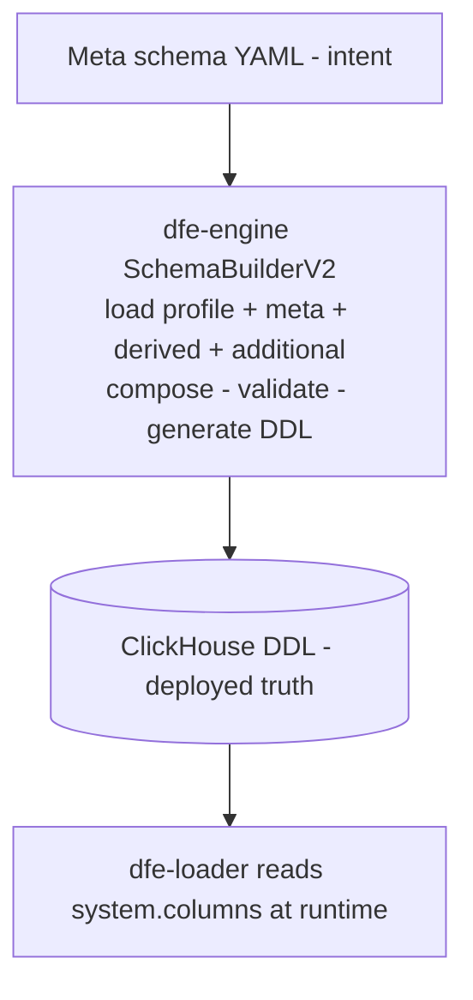
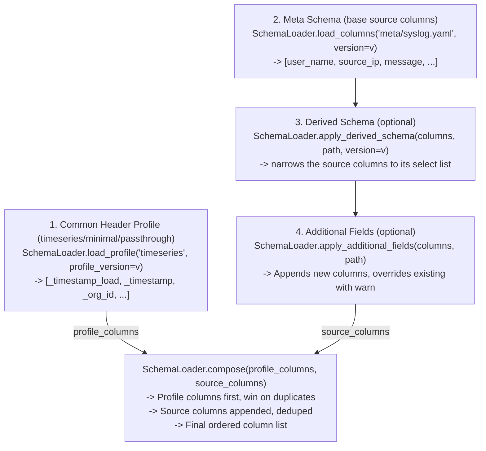

# Meta Schema System

A **meta schema** is a YAML file that defines the columns for a ClickHouse
table - the single source of intent for what a table should look like. The
engine reads it, generates DDL, and applies it to ClickHouse. This page is the
FORMAT reference. The engine classes that consume it are documented in the
dfe-engine repo (`docs/data-plane/schema-classes.md`).



Two sources of truth exist:

1. Meta schema YAML -- what the schema should be
2. ClickHouse table -- what the schema actually is

The engine bridges the gap. dfe-loader reads the deployed ClickHouse schema only,
from `system.columns` at runtime, never YAML.

## Where Meta Schemas Live

Meta schemas are YAML files at the root of this repo
([dfe-schemas](https://github.com/hyperi-io/dfe-schemas)), shipped to consumers as the
pinned `dfe-schemas` PyPI wheel. Common header profiles,
hunt result schemas, and source-specific schemas all use the same format.

```text
dfe-schemas/                      <- repo root, shipped as a PyPI wheel
|-- common-header/
|   |-- timeseries.yaml           <- the default profile
|   |-- minimal.yaml              <- the high-volume profile
|   '-- passthrough.yaml          <- the transparent bridge
|-- compat-profiles/              <- rule rows that read another platform's header (compat-profiles.md)
|-- meta/                         <- source meta schemas, one directory per provider, plus syslog.yaml
|-- additional/                   <- extra-field overlays (<package>/<data_stream>, snapshot/)
|-- derived/                      <- derived schemas: a select list over a base
|-- dlq/entry.yaml                <- the dead-letter columns composed onto the header
'-- hunts/
    |-- results.yaml              <- hunt detection output columns
    '-- detection_checkpoint.yaml <- runner checkpoint table
```

---

## YAML Format

Meta schemas support two layouts: **version tree** (preferred) and **flat** (backward-compatible).

### Version Tree (Preferred)

Each version carries a complete column snapshot. No filtering or reconstruction needed --
read `versions."1.0.0".columns` and you have the full schema for that version.

```yaml
current: "1.0.0"                      # Default version when no pin specified

versions:
  "1.0.0":
    date: "2026-01-15"
    type: model                       # model | addition | revision
    summary: "Initial schema"
    columns:
      - name: user_name
        type: string
        use_case: dimension
        expr: "@source: first(user_id/uid/id)"
        comment: "User identifier"

      - name: source_ip
        type: ip
        use_case: range
        expr: "@source: src_ip"
        comment: "Source IP address"

      - name: message
        type: text
        use_case: word_search
        comment: "Log message body"
```

### Flat (Backward-Compatible)

Files without `current`/`versions` metadata work unchanged. No versioning -- just a
plain column list.

```yaml
columns:
  - name: user_name
    type: string
    use_case: dimension
  - name: message
    type: text
    use_case: word_search
```

### Version Metadata Fields

| Field | Required | Description |
|-------|----------|-------------|
| `current` | Yes | Default version when consumer doesn't specify a pin |
| `versions` | Yes | Dict of version string -> version entry |
| `date` | Yes (per version) | When the version was created (YYYY-MM-DD) |
| `type` | Yes (per version) | Change category: `model`, `addition`, `revision` |
| `summary` | Yes (per version) | Human-readable change description |
| `columns` | Yes (per version) | Complete column snapshot for this version |
| `profile_exclude` | No (per version) | Common-header columns to drop when this schema is composed onto a profile |

`profile_exclude` trims the header for a table that does not need all of it.
`hunts/results.yaml` uses it to drop `_raw` and `_tags`: a detection row
references its source by `matched_uuid`, so a second copy of the payload text
plus an ngram index over it is storage for nothing. Naming a column that the
profile does not have is a no-op, not an error - a profile can legitimately
lack it (`minimal` has no `_raw`).

---

## Column Definition Reference

Each column is a `SchemaColumn`. Only `name` and `type` are required.

```yaml
columns:
  - name: _org_id                    # Required: column name
    type: string                     # Required: primitive type
    cardinality: low                 # Optional: low | high | unknown
    use_case: dimension              # Optional: query pattern -> index
    attribute: [not_null]            # Optional: storage modifiers
    default: null                    # Optional: DEFAULT expression
    order: 2                         # Optional: ORDER BY position
    expr: "@source: _org_id"         # Optional: DFE loader directive
    comment: "Tenant identifier"     # Optional: human description
    ch_override: null                # Optional: exact ClickHouse type
```

### Field Reference

| Field | Type | Default | Description |
|-------|------|---------|-------------|
| `name` | `str` | *(required)* | Column name. System fields use `_` prefix to avoid collision with source data. |
| `type` | `str` | *(required)* | Primitive type -- one of the primitives in `registries/types.yaml` (see [Type System](#type-system)). |
| `cardinality` | `str` | `unknown` | How many distinct values the column holds: `low`, `high` or `unknown` (see [Cardinality](#cardinality)). |
| `attribute` | `list[str]` | `[]` | Storage attributes: `nullable`, `not_null`, `materialized`, `alias`, and the retired `lowcardinality`. Accepts a single string or list. |
| `use_case` | `str \| null` | `null` | The question the column is asked, which determines index generation: `dimension`, `exact_match`, `range`, `word_search`, `substring_search`, `key_search`, `similarity_search(<dims>)`. |
| `default` | `str \| null` | `null` | Raw ClickHouse DEFAULT expression (e.g. `"now64(3)"`, `"generateUUIDv7()"`). Used as MATERIALIZED or ALIAS expr when those attributes are set. |
| `order` | `int \| null` | `null` | Position in ORDER BY / PRIMARY KEY (0-based). Only columns with `order` set are included in the key. |
| `expr` | `str \| null` | `null` | DFE directive that tells the loader how to populate this column (see [DFE Expressions](#dfe-expressions)). |
| `comment` | `str \| null` | `null` | Human-readable description. |
| `ch_override` | `str \| null` | `null` | Exact ClickHouse type string -- bypasses primitive mapping entirely. No auto-Nullable, no auto-codec. |
| `codec` | `str \| null` | `null` | CODEC arguments, emitted verbatim in place of the primitive's codec. The only way to give a `ch_override` column one. |
| `_field_type` | `str \| null` | `null` | Column classification annotation (`base` = shipped by DFE). Maps to the engine model's `field_type`. |
| `max_dynamic_paths` | `int \| null` | `null` | JSON-column dynamic-path budget. Rendered as `JSON(max_dynamic_paths=N)` on a bare `JSON` column, and ignored on any other type. |
| `synthetic` | `map \| null` | `null` | Synthetic data generation hints (see [Synthetic Data Hints](#synthetic-data-hints)). Ignored by the schema loader and DDL generation. |

### Synthetic Data Hints

A column may carry an optional `synthetic:` mapping that the DFE synthetic
data generator uses when producing synthetic data from this schema - a
realistic continuous inbound stream for sales demos, and repeatable data
for testing. The schema loader ignores the key, so hints never affect
validation or DDL.
Hints are applied in priority order - `static` > `values` > `templates` >
`provider` > `minimum`/`maximum` - and columns without hints fall back to
the engine's semantic heuristics (name/type based).

| Hint | Type | Description |
|------|------|-------------|
| `static` | any | Emit this exact value for every event. |
| `values` | `list` | Categorical vocabulary to draw from. |
| `weights` | `list[float]` | Draw weights aligned with `values`. |
| `templates` | `list[str]` | Message templates with `{placeholder}` tokens filled from the event's entity context (`{username}`, `{ipv4}`, `{external_ipv4}`, `{port}`, `{http_status}`, ...). |
| `provider` | `str` | Faker provider method to call (e.g. `user_agent`). |
| `minimum` / `maximum` | number | Bounds for numeric generation. |
| `format` | `str` | Timestamp rendering: `iso8601` (default), `epoch_s`, `epoch_ms`, or a strftime pattern. |

### Synthetic Data Scenarios

Correlated columns must not draw independently (an sshd message under
`appname: cron` reads as fake). A version entry may carry a `synthetic:`
mapping BESIDE `columns:` whose `scenarios:` list defines coherent
events - one weighted scenario is drawn per event, and its
`values`/`templates` override per-column hints for the columns it names:

```yaml
versions:
  "1.0.0":
    columns: [...]
    synthetic:
      scenarios:
        - name: sshd-auth
          weight: 35
          values:
            app_name: sshd
            facility: [auth, authpriv]     # list draws uniformly
            severity: [info, info, notice] # repeat entries to weight
          templates:
            message:
              - "Failed password for {username} from {external_ipv4} port {port} ssh2"
```

Columns a scenario does not name fall back to per-column hints, then
heuristics. The shipped reference sets (`meta/syslog.yaml`,
`meta/otel/logs.yaml`, `meta/beats/filebeat.yaml`) use scenarios for the
correlated columns and hints for the rest.

### How `expr` and `comment` Become DDL

In the generated DDL, `expr` and `comment` are combined into a single ClickHouse COMMENT
clause. The loader parses the `@` directives it acts on from the COMMENT at runtime
(see [DFE Expressions](#dfe-expressions) for which ones):

```sql
-- Both expr and comment:
`_timestamp` DateTime64(3,'UTC') COMMENT '@source: timestamp | now() - Event timestamp'

-- Expr only (descriptive -- the DEFAULT clause is what the loader actually reads):
`_uuid` UUID DEFAULT generateUUIDv7() COMMENT '@generated: generateUUIDv7()'

-- Comment only:
`matched_uuid` UUID COMMENT 'UUID of the matching source record'
```

---

## Type System

### Primitives

Primitives are human-readable type names that map to ClickHouse types with sensible
defaults. You don't need to know ClickHouse storage internals -- pick the primitive
that describes your data. `registries/types.yaml` holds the mapping below.

| Primitive | What It Is | ClickHouse Type | Codec | Nullable Default |
|-----------|-----------|-----------------|-------|-----------------|
| `string` | Short-to-medium text (names, IDs, codes) | `String` | `ZSTD(1)` | Yes |
| `text` | Large text (log messages, bodies) | `String` | `ZSTD(3)` | Yes |
| `integer` | Whole number (counts, IDs, event codes) | `Int64` | `ZSTD(1)` | Yes |
| `float` | Decimal number (scores, latency) | `Float64` | `ZSTD(1)` | Yes |
| `boolean` | True/false | `Bool` | `LZ4` | **No** |
| `datetime` | Date and time with timezone | `DateTime64(3,'UTC')` | `Delta, ZSTD(1)` | Yes |
| `timestamp` | Date and time -- never null (for ORDER BY) | `DateTime64(3,'UTC')` | `Delta, LZ4` | **No** |
| `date` | Date only | `Date` | `Delta, ZSTD(1)` | Yes |
| `ip` | IP address (v4 or v6) | `IPv6` | `LZ4` | Yes |
| `uuid` | Unique identifier | `UUID` | *(none)* | Yes |
| `json` | Structured/semi-structured data | `JSON` | `ZSTD(3)` | Yes |
| `geo_point` | Latitude/longitude pair | `Point` | `ZSTD(1)` | Yes |
| `enum` | Fixed set of allowed values | `Enum8(...)` | `ZSTD(1)` | **No** |
| `map` | String-keyed attributes (labels, tags) | `Map(LowCardinality(String), String)` | `ZSTD(1)` | **No** |
| `vector` | Embedding for similarity search | `Array(Float32)` | `ZSTD(1)` | **No** |

ClickHouse refuses `Map` and `Array` inside `Nullable`, so neither of the last two
can be null.

### Type Wrapping

Nullable comes from the primitive's default and the `nullable` / `not_null`
attributes. LowCardinality comes from `cardinality` and nothing else:

```text
string                                  -> Nullable(String)
string + cardinality: low               -> LowCardinality(Nullable(String))
string + cardinality: low + [not_null]  -> LowCardinality(String)
string + cardinality: high              -> Nullable(String)
timestamp                               -> DateTime64(3,'UTC')   (not nullable by default)
boolean                                 -> Bool                  (not nullable by default)
```

Wrapping order: **Nullable wraps inner**, **LowCardinality wraps outer**.

### ClickHouse Type Override (`ch_override`)

When a primitive isn't sufficient, specify the exact ClickHouse type:

```yaml
  - name: http_status
    type: integer
    ch_override: UInt16
    use_case: dimension

  - name: precision_ts
    type: datetime
    ch_override: "DateTime64(6,'UTC')"

  - name: nested_data
    type: string
    ch_override: "Nested(key String, value String)"
```

When `ch_override` is set:

- The column is NOT NULL whatever the primitive's default, unless it carries the
  `nullable` attribute
- It takes no codec but one it declares in `codec`
- `cardinality: low` still wraps it in `LowCardinality(...)`, and `max_dynamic_paths`
  still applies to a bare `JSON`

The engine validates `ch_override` against the `ch_overrides` list in
`registries/types.yaml`: integers, floats, decimals, strings, dates, geo, complex
types, enums and the specials.

---

## Cardinality

How many distinct values the column holds. One declaration, because it decides
two things that must agree: the storage wrapper, and whether `exact_match`
chooses `set(0)` or `bloom_filter`.

| Value | Storage | `exact_match` index |
|-------|---------|---------------------|
| `low` | `LowCardinality(...)` | `set(0)` -- holds every distinct value exactly |
| `high` | plain | `bloom_filter` -- bounded, probabilistic |
| `unknown` *(default)* | plain | `bloom_filter` |

`unknown` is the honest default. Nobody re-reviews a field that already looks
decided, so a column with nothing measured says so, and gets the safe way to be
wrong: no dictionary, and an index whose cost does not grow with the column.

Measure it rather than guess it. An Elasticsearch index template does not carry
cardinality, so dfe-engine's template importer leaves an imported column
`unknown`, and so is every column of `meta/elastic/ecs.yaml`. The importer's
one exception is a `constant_keyword`, which it reads as `low` because it holds
one value.

A default ClickHouse creates `LowCardinality` over `String`, `FixedString` and
`UUID` only, and refuses the rest with code 455. So `cardinality: low` belongs on
a `string` or `text` column.

`attribute: [lowcardinality]` is the retired spelling and still reads as
`cardinality: low`. Declaring the two against each other is refused.

---

## Attributes

Attributes modify how the type is stored. Specified as a list in YAML.

| Attribute | What It Does | Valid Primitives |
|-----------|-------------|-----------------|
| `lowcardinality` | Retired -- the old spelling of `cardinality: low` | `string`, `text` |
| `nullable` | Force NULL allowed (overrides primitive default) | all |
| `not_null` | Force NOT NULL (overrides primitive default) | all |
| `materialized` | Column computed on INSERT, not stored in source data | all |
| `alias` | Virtual column computed at query time | all |

The list is `attributes.<name>.valid_primitives` in `registries/types.yaml`, which
dfe-engine validates a column against.

### How Attributes Interact with `default`

The `default` field produces different DDL clauses depending on attributes:

| Attributes | DDL Clause |
|-----------|-----------|
| *(none)* | `DEFAULT {default}` |
| `[materialized]` | `MATERIALIZED {default}` |
| `[alias]` | `ALIAS {default}` |

```yaml
# Materialized: computed on insert from other columns
  - name: day
    type: date
    attribute: [materialized]
    default: "toDate(_timestamp)"

# Alias: virtual, computed at query time
  - name: year
    type: integer
    attribute: [alias]
    default: "toYear(_timestamp)"
```

### Nullability Defaults

Each primitive has a default nullability. Override with `nullable` or `not_null`:

`string`, `text`, `integer`, `float`, `datetime`, `date`, `ip`, `uuid`, `json`
and `geo_point` are Nullable by default. `timestamp`, `boolean`, `enum`, `map`
and `vector` are NOT NULL by default.

A `Nullable(T)` column stores a separate null map beside its data, which costs
storage and read speed. A Nullable sort key needs `allow_nullable_key`, so the
manifest renderer refuses one and dfe-engine drops it from a source table's key
with a warning. `timestamp`, the primitive meant for a sort key, is never null.

---

## Use Cases

A use case names **the question you ask the column** -- never the ClickHouse index
that answers it. You declare the question, the DDL catalogue picks the index, and
it can pick a different one on a later ClickHouse without your schema changing.

| Use Case | The question | Example Columns |
|----------|------------|-----------------|
| `dimension` | I filter and group by this: `WHERE status = 'error'` | status, severity, org_id |
| `exact_match` | I look up specific values | trace_id, request_id |
| `range` | I query ranges, between, time windows: `WHERE latency > 100` | latency_ms, timestamp |
| `word_search` | I search for whole words: `WHERE hasToken(message, 'error')` | message, log_body |
| `substring_search` | I search for fragments inside words: `WHERE message LIKE '%refused%'` | syslog_message |
| `key_search` | I search the keys and values of a map column | attributes, labels |
| `similarity_search(<dims>)` | I find records similar to this one | embedding |
| *(empty)* | No index | raw payload, metadata |

`similarity_search` is the one use case that takes an argument: ClickHouse needs
the vector's dimension count up front and cannot read it off the column.

### Use Case -> Primitive Constraints

| Use Case | Valid Primitives |
|----------|-----------------|
| `dimension` | `string`, `integer`, `boolean`, `enum`, `ip`, `uuid` |
| `exact_match` | `string`, `uuid`, `integer`, `ip` |
| `range` | `integer`, `float`, `datetime`, `timestamp`, `date`, `ip` |
| `word_search` | `string`, `text` |
| `substring_search` | `string`, `text` |
| `key_search` | `map` |
| `similarity_search` | `vector` |

Invalid combinations are rejected at validation time (e.g. `word_search` on an `integer`).

### Generated ClickHouse Indexes

What each use case renders on the ClickHouse the stack pins. These are the answers, not
part of the vocabulary -- read them to size the cost, not to name a column. They
live as data in `registries/ddl.yaml`, the DDL catalogue, read through
`dfe_schemas.ddl_catalogue`. A changed answer is a catalogue edit and a
dfe-schemas release, not a code change.

| Use Case | Index Type | Granularity | Notes |
|----------|-----------|-------------|-------|
| `dimension` | `set(0)`, or `bloom_filter` on a Nullable column | 4 | `set(0)` holds the exact distinct values per granule, but prunes nothing on a Nullable column on 26.3 |
| `exact_match` | `set(0)` on `cardinality: low` when not Nullable, else `bloom_filter` | 4 | The bloom filter is probabilistic -- false positives, no false negatives. It takes `IPv6`, and on an `Array` column it answers `has()`, `hasAny()` and `hasAll()` |
| `range` | `minmax` | 4 | Stores min/max per granule |
| `word_search` | `text(tokenizer=splitByNonAlpha)` | 1 | GA text index (v26.2+). Deterministic, row-level filtering. |
| `substring_search` | `text(tokenizer=ngrams(3))` | 1 | Character n-gram text index for substring matching. |
| `key_search` | two indexes, `text(tokenizer=array)` over `mapKeys(col)` and `mapValues(col)` | 1 | A text index refuses a `Map` column itself, so the keys and the values are indexed apart |
| `similarity_search(<dims>)` | `vector_similarity('hnsw', 'cosineDistance', <dims>)` | 100000000 | One index per part: at granularity 1 each granule gets its own graph and the top-k comes back wrong. `hnsw` is the only method 26.3 implements |

The catalogue holds one answer per use case. `tokenbf_v1` and `ngrambf_v1` are
not among them: the ClickHouse DFE ships deprecates both in favour of the text
index.

### Which use case for which question

| You look for | Declare | Query it as |
|--------------|---------|-------------|
| One id, hash or user among millions | `exact_match` on a `string` or `uuid` | `col = 'x'`, `col IN (...)` |
| One IP address | `exact_match` on an `ip` | `src_ip = toIPv6('10.1.2.3')` |
| A value inside an array column | `exact_match` on the element's primitive, with `ch_override: Array(...)` | `has(col, 'x')`, `hasAny`, `hasAll` |
| A numeric id or event code with many values | `exact_match` on an `integer` | `col = 4624` |
| A handful of values, filtered and grouped | `dimension`, with `cardinality: low` | `col = 'error'`, `GROUP BY col` |
| A time window, a numeric range, an address range | `range` | `col > 100`, `ip BETWEEN toIPv6('10.0.0.0') AND toIPv6('10.255.255.255')` |
| A whole word in free text | `word_search` | `hasToken(col, 'refused')`, `hasAnyTokens`, `hasAllTokens` |
| A fragment of at least 3 characters | `substring_search` | `col LIKE '%efuse%'` |
| A key or value in a map | `key_search` | `mapContainsKey(col, 'k')`, `has(mapValues(col), 'v')` |
| The nearest embeddings | `similarity_search(<dims>)` | `ORDER BY cosineDistance(col, [...]) LIMIT 10` |

A vector search with a narrow `WHERE` can return fewer than the `LIMIT`: ClickHouse takes the index's k nearest, then filters them.

An address range is a `BETWEEN` on the two ends: `isIPAddressInRange()` reads
every row, because no index can prune it.

`exact_match` on an `integer` or an `ip` is a bloom filter. `range` stores
min and max per granule, which prunes only when the values arrive roughly in
order. A lookup on one address in unsorted traffic needs `exact_match`.

---

## DFE Expressions

The `expr` field carries directives, emitted as ClickHouse column comments. The
Rust loader reads them back from `system.columns` at runtime and parses the six
names in `DIRECTIVE_NAMES` (dfe-loader `src/column_meta/mod.rs`): `@skip`,
`@default`, `@source`, `@renamed`, `@computed` and `@coerce`. `@generated` and
`@config` are not among them, so the loader drops both as unknown directives.

| Directive | Purpose | Example | Loader-parsed |
|-----------|---------|---------|----------------|
| `@source: field` | Copy from source data | `@source: timestamp \| now()` | Yes |
| `@source: first(a/b/c)` | First non-null from list | `@source: first(user_id/uid/id)` | Yes |
| `@renamed: field` | Zero-copy field rename | `@renamed: logoriginal` | Yes |
| `@computed: expr` | Derived/enriched value | `@computed: geoip(ip).country_code` | Yes |
| `@default: value` | Substitute when the column is null or absent | `@default: unknown` | Yes |
| `@skip` | Leave the column out of the insert | `@skip` | Yes |
| `@coerce: category` | Override the type category for coercion | `@coerce: IPv4` | Parsed, then ignored with a warning: no encoder reads it |
| `@generated: expr` | Descriptive: ClickHouse generates via DEFAULT | `@generated: now64(3)` | No -- see below |
| `@config: path` | Descriptive: mapping is configurable | `@config: routing.org_id_field` | No -- see below |

`@generated` describes a DEFAULT/MATERIALIZED/ALIAS clause that already lives
in the column's own `default:`/`attribute:` fields. The loader omits the field
because it reads that clause's kind straight from `system.columns`
(`default_kind`), not because it parsed the `@generated:` text. `@config`
documents that some other field's value is driven by loader config (for
example `routing.org_id_field`) rather than hardcoded -- the loader never
reads the comment's path to resolve it. dfe-loader's `docs/clickhouse/ddl-directives.md`
has the full mechanism:
<https://github.com/hyperi-io/dfe-loader/blob/main/docs/clickhouse/ddl-directives.md>.

In the header profiles `_raw` and `_json` carry no directive: what they hold
depends on the loader's capture mode. A `@source` on `_json` makes the loader
read that field instead, as the dead-letter table's does.

dfe-loader's own config beats a column comment. A `column_directives` entry
overrides the directive on that column, and `_org_id` is filled from
`routing.org_id_field` alone, never from a directive.

---

## Common Header Profiles

A source table starts with a standard header of underscore-prefixed system
fields, the deployment's default profile when it names none, and so do the
landing, dead-letter and detection tables. The profile determines which header
columns are included.

### Profile Summary

| Profile | Columns | Use Case |
|---------|---------|----------|
| **timeseries** (default) | 9 | Logs, alerts, audit trails -- full event ingestion |
| **minimal** | 5 | Metrics, flow records -- high-volume structured data |
| **passthrough** | 4 | Transparent bridge -- no timestamp injection |

### timeseries (default) -- 9 columns

| Column | Type | Cardinality | Use Case | ORDER BY | Expr |
|--------|------|-------------|----------|----------|------|
| `_timestamp_load` | `timestamp` | | | 0 | `@generated: now64(3)` |
| `_timestamp` | `timestamp` | | `range` | 1 | `@source: timestamp \| now()` |
| `_timestamp_received` | `timestamp` | | | | `@source: first(_timestamp_received/timestamp_received/received_at)` |
| `_uuid` | `uuid` | | | | `@generated: generateUUIDv7()` |
| `_org_id` | `string` | `low` | `dimension` | 2 | `@source: _org_id` |
| `_source` | `string` | `low` | `dimension` | | `@source: first(_source) \| topic_name` |
| `_raw` | `text` | | `substring_search` | | capture mode |
| `_json` | `json` | | | | capture mode |
| `_tags` | `json` | | | | `@source: first(_tags/tags/meta/metadata.tags)` |

Each header field reads its `_`-prefixed wire name first, except the event timestamp. The header expects the first hop, dfe-receiver or dfe-fetcher, to stamp `_org_id` and `_timestamp_received` on every record. dfe-loader fills `_org_id` from its `routing.org_id_field`, `_org_id` by default, and never from the column's directive, which records the field rather than choosing it. A sender's own spelling of the tenant, such as a DFE 2.x `org_id`, reaches `_org_id` only through a [compatibility profile](compat-profiles.md) at the first hop.

### minimal -- 5 columns

`_timestamp_load`, `_timestamp`, `_uuid`, `_org_id`, `_json`

### passthrough -- 4 columns

`_timestamp_load`, `_uuid`, `_org_id`, `_json`

### How a Source Selects a Profile

```yaml
# In the Source YAML:
header:
  type: timeseries          # Profile name
  version: "1.0.0"          # Pin to specific profile version
```

Profile columns are injected first. Source-specific columns follow.
If a source column duplicates a profile column name, the profile wins (with warning).

---

## Composition Pipeline

A fully composed schema is built from up to four layers:



### How It's Wired in a Source YAML

```yaml
source: windows_audit
header:
  type: timeseries
  version: "1.0.0"
schema:
  meta_schema: meta/windows_audit.yaml        # Layer 2: base columns
  meta_schema_version: "2.1.0"                # Pin meta schema version
  derived_schema: derived/windows_custom.yaml  # Layer 3: narrows to a select list
  additional_fields: additional/windows_extra.yaml  # Layer 4: extra columns
  ttl_days: 90
  engine: MergeTree
```

Schema file paths are resolved relative to `schemas_base_dir` (the schemas directory).

### Composition Semantics

| Layer | Merge behaviour |
|-------|----------------|
| **Profile** | Always comes first. Profile columns cannot be overridden by source columns. |
| **Meta schema** | Base source-specific columns. |
| **Derived schema** | Narrows the source columns to its `select` list, in that order. A selected column may override `index` and nothing else, and a name the base lacks is an error. |
| **Additional fields** | New columns are appended. Existing names override with warning. |

---

## DDL Generation

`dfe_schemas.render.render_table(spec)` renders a table that is not a manifest
object, such as a source table, from a `TableSpec`. It runs the same `TableDDL`
code the manifest renderer does, so the two cannot drift.

The engine generates complete ClickHouse DDL from composed columns. Here is the
`CREATE TABLE` statement for the `timeseries` profile plus the three source
columns from the example above, with `ttl_days: 90`, rendered for self-hosted
ClickHouse:

```sql
-- =============================================================================
-- DFE Schema DDL: windows_audit
-- Profile: timeseries
-- Generated by: dfe-engine DDLFileWriter
--
-- This file was auto-generated. Use {db} as database placeholder.
-- =============================================================================
CREATE TABLE IF NOT EXISTS `{db}`.`windows_audit`
(
    `_timestamp_load` DateTime64(3,'UTC') DEFAULT now64(3) COMMENT '@generated: now64(3) - Insertion timestamp (ms precision)' CODEC(Delta, LZ4),
    `_timestamp` DateTime64(3,'UTC') COMMENT '@source: timestamp | now() - Event timestamp from source data' CODEC(Delta, LZ4),
    `_timestamp_received` DateTime64(3,'UTC') COMMENT '@source: first(_timestamp_received/timestamp_received/received_at) - When DFE first received the event: the dfe-receiver or dfe-fetcher stamp' CODEC(Delta, LZ4),
    `_uuid` Nullable(UUID) DEFAULT generateUUIDv7() COMMENT '@generated: generateUUIDv7() - Time-ordered unique event identifier',
    `_org_id` LowCardinality(String) COMMENT '@source: _org_id - Tenant/organisation identifier' CODEC(ZSTD(1)),
    `_source` LowCardinality(Nullable(String)) COMMENT '@source: first(_source) | topic_name - Data source label (e.g. beats, syslog, crowdstrike-edr)' CODEC(ZSTD(1)),
    `_raw` Nullable(String) COMMENT 'Raw payload text, when the loader\'s capture mode writes one. A JSON payload lands in _json instead, so _raw is often empty. (full-text indexed)' CODEC(ZSTD(3)),
    `_json` JSON(max_dynamic_paths=2048) COMMENT 'The payload as structured JSON, when the loader\'s capture mode writes one' CODEC(ZSTD(3)),
    `_tags` JSON COMMENT '@source: first(_tags/tags/meta/metadata.tags) - Event metadata tags' CODEC(ZSTD(3)),
    `user_name` Nullable(String) COMMENT '@source: first(user_id/uid/id) - User identifier' CODEC(ZSTD(1)),
    `source_ip` Nullable(IPv6) COMMENT '@source: src_ip - Source IP address' CODEC(LZ4),
    `message` Nullable(String) COMMENT 'Log message body' CODEC(ZSTD(3)),
    INDEX `idx__timestamp` `_timestamp` TYPE minmax GRANULARITY 4,
    INDEX `idx__org_id` `_org_id` TYPE set(0) GRANULARITY 4,
    INDEX `idx__source` `_source` TYPE bloom_filter GRANULARITY 4,
    INDEX `idx__raw` `_raw` TYPE text(tokenizer=ngrams(3)) GRANULARITY 1,
    INDEX `idx_user_name` `user_name` TYPE bloom_filter GRANULARITY 4,
    INDEX `idx_source_ip` `source_ip` TYPE minmax GRANULARITY 4,
    INDEX `idx_message` `message` TYPE text(tokenizer=splitByNonAlpha) GRANULARITY 1
)
ENGINE = ReplicatedMergeTree
PARTITION BY toYYYYMMDD(_timestamp_load)
PRIMARY KEY (`_timestamp_load`, `_timestamp`, `_org_id`)
ORDER BY (`_timestamp_load`, `_timestamp`, `_org_id`)
TTL _timestamp_load + INTERVAL 90 DAY DELETE WHERE _timestamp_load >= 0
SETTINGS
    index_granularity = 2048,
    ttl_only_drop_parts = 1,
    merge_max_dynamic_subcolumns_in_wide_part = 64,
    write_marks_for_substreams_in_compact_parts = 0
COMMENT '@profile: timeseries | @profile_version: 1.0.3 | @windows_audit_version: 2';
```

`_source` and `user_name` are Nullable dimensions, so they take `bloom_filter`
where `_org_id`, which is not, takes `set(0)`. On ClickHouse Cloud the last
setting is left out.

Clauses follow ClickHouse's order: `ENGINE`, `PARTITION BY`, `PRIMARY KEY` and
`ORDER BY`, `SAMPLE BY`, `TTL`, `SETTINGS`, then `COMMENT`. There is no projection
unless `projection_order_by` is set.

### Table SETTINGS

| Setting | Emitted when | Value |
|---------|--------------|-------|
| `index_granularity` | Always | `DDLConfig.index_granularity` |
| `ttl_only_drop_parts` | The table has a TTL and `ttl_only_drop_parts` is true | `1` when every TTL column appears in the `PARTITION BY` expression, else `0`. An unaligned TTL then deletes rows instead of dropping parts, because a part is dropped only once every row in it has expired. |
| `merge_max_dynamic_subcolumns_in_wide_part` | Any column resolves to `JSON` or a type wrapping it | `JSON_TABLE_SETTINGS` in `dfe_schemas/deploy_defaults.py` |

Uncapped, a merge over a JSON column with free-form keys writes one stream per
dynamic subcolumn and runs ClickHouse out of memory. `json_table_settings()` in
`deploy_defaults.py` decides whether a table carries the cap, after dropping quoted
literals so an `Enum8('JSON' = 1)` label does not count, and adds the platform's own
JSON settings from `dfe_schemas/sql/platform.sql`
(`write_marks_for_substreams_in_compact_parts = 0` on self-hosted only). Every table
renderer (`Renderer` for the manifest tables, the engine's `DDLGenerator` for source
tables) emits them on `CREATE`. dfe-engine also issues `ALTER TABLE ... MODIFY SETTING`
on a JSON table that exists without them or with another value, and `RESET SETTING`
for a platform-only setting the platform does not take, on engine start and on a
source redeploy. Any other setting the table carries is left alone.

### DDL Configuration (`DDLConfig`)

| Field | Default | Description |
|-------|---------|-------------|
| `db` | `"{db}"` | Database placeholder (replaced at deploy time) |
| `engine` | `"MergeTree"` | Engine variant, with its arguments if it takes any (`ReplacingMergeTree(ver)`). The renderer adds the `Replicated` prefix, never this field. |
| `ttl_days` | `None` | Data retention in days. `None` is undeclared and adds no TTL. `0` declares none. |
| `ttl_columns` | `partition_column` from the `table` block of `registries/ddl.yaml`, as a one-item list | Columns used in TTL expressions. The partition column alone, so `ttl_only_drop_parts` can drop whole parts. `ttl_days` over an empty list, or over a column the table lacks, is refused. |
| `partition_column` | The `table` block of `registries/ddl.yaml` | Column `PARTITION BY` is built from. No `PARTITION BY` when the table lacks it. |
| `partition_granularity` | The `table` block of `registries/ddl.yaml` | `day` gives `toYYYYMMDD(column)`, `month` gives `toYYYYMM(column)`. |
| `partition_by` | `None` | A raw `PARTITION BY` expression, emitted verbatim. Wins over `partition_column` and `partition_granularity`. |
| `order_by` | `None` | A raw `ORDER BY` expression. Wins over the columns' own `order` positions, and sets no `PRIMARY KEY` unless `primary_key` is also set. |
| `primary_key` | `None` | A raw `PRIMARY KEY` expression. Used only with `order_by`. |
| `extra_indexes` | `[]` | Raw `INDEX` definitions appended to the column list. |
| `index_granularity` | The `table` block of `registries/ddl.yaml` | ClickHouse granule size |
| `ttl_only_drop_parts` | `True` | Emit the `ttl_only_drop_parts` setting on a table with a TTL. See Table SETTINGS. |
| `sample_by` | `None` | Optional `SAMPLE BY` expression |
| `projection_order_by` | `None` | Column for a `SELECT * ORDER BY` projection named `<column>_optimized`. Off unless set: on a JSON-heavy table the projection copies every column and doubles the substream metadata ClickHouse holds in memory. |
| `schema_version` | `None` | Written to the table comment as `@<table>_version`. |
| `profile_name` | `None` | Profile name for the table comment and header. |
| `profile_version` | `None` | Profile version for the table comment |
| `description` | `None` | A line in the header comment |

The manifest tables under `tables/` are rendered by `dfe_schemas/render.py`, whose
`table:` block defaults differ: `ttl_columns` is empty and `projection_order_by` is
unset, so a table declares its TTL columns itself or keeps every row. Its
`ttl_days` falls back to the deployment default only when `ttl_columns` is set.
Its `partition_column`, `partition_granularity` and `index_granularity` defaults,
and the granularity -> function map behind `PARTITION BY`, come from the `table`
block of `registries/ddl.yaml`.
`docs/tables.md` has the block.

### Table Comment Metadata

The generated table comment contains machine-readable tags:

```sql
COMMENT '@profile: timeseries | @profile_version: 1.0.0 | @windows_audit_version: 2'
```

The tags are `@profile`, `@profile_version` and `@<table>_version` (from
`schema_version`), each present only when its field is set. A manifest table
rendered from a header carries `@profile` and `@profile_version` only. This lets
migration tooling detect a table's schema version and profile at runtime.

### Views

The engine generates `CREATE OR REPLACE VIEW` statements for the field mapping
standards under `registries/field-maps/` (CIM, ECS, OCSF, Sigma). A view aliases
source column names to standard field names, sorted by standard field:

```sql
CREATE OR REPLACE VIEW `{db}`.`windows_audit_sigma` AS
SELECT
    `event_id` AS `EventID`,
    `source_ip` AS `SourceIP`,
    `user_name` AS `User`,
    *
FROM `{db}`.`windows_audit`;
```

Zero storage overhead -- views are computed at query time.

---

## Version Management

### Immutable Versions

Published version entries are **never modified**. To change a schema:

1. Add a new version entry with the updated column snapshot
2. Update `current` to point to the new version
3. Commit

### SchemaVer Semantics

Uses SemVer format (`MAJOR.MINOR.PATCH`) with schema-specific semantics:

| Change | Bump | Description | Migration Safety |
|--------|------|-------------|------------------|
| **MODEL** | Major | Column removed, type changed, ORDER BY changed | Manual review required |
| **ADDITION** | Minor | New column added, new default expression | Safe auto-migrate (`ALTER TABLE ADD COLUMN`) |
| **REVISION** | Patch | Comment updated, attribute tweaked | No DDL change |

### Version Pinning

Different sources can pin different versions from the same file:

```yaml
# Source A: pinned to header v1.0.0
header:
  type: timeseries
  version: "1.0.0"
schema:
  meta_schema: meta/syslog.yaml
  meta_schema_version: "1.0.0"

# Source B: pinned to header v1.0.0, meta v2.0.0
header:
  type: timeseries
  version: "1.0.0"
schema:
  meta_schema: meta/syslog.yaml
  meta_schema_version: "2.0.0"
```

No pin (`meta_schema_version: null`) uses the file's `current` marker.

---

## Schema Lifecycle

| Event | DDL Action |
|-------|-----------|
| Source created | `CREATE TABLE IF NOT EXISTS` from profile + source schema |
| Schema field added | `ALTER TABLE ADD COLUMN IF NOT EXISTS` |
| Schema field modified | No column is retyped. Its index moves to the one it declares, and the table's TTL to its version's |
| Source disabled | No DDL change -- table stays, no new data |
| Source deleted | Table preserved -- manual `DROP TABLE` if needed |

The deployed ClickHouse table is always authoritative at runtime.

---

## Using Meta Schemas in the dfe-schemas Repo

### Generating a Meta Schema from Live Rows

A provider whose export is wider than its documentation (runZero's is) gets
its meta schema from a dump of real rows, not from the docs:
`scripts/generate_meta_schemas.py` reads a directory of `<store>.jsonl` files
(one JSON object per line), takes the union of keys across every row, types
each column from the values it saw, and writes `meta/<provider>/<store>.yaml`
in the version-tree layout. The typing rules, the row-key handling and the
`ch_override: Array(...)` escape for list values are in the script's
docstring. The provider's arguments live in an `@` file beside it
(`scripts/meta-runzero.args`), so a regeneration is one command and
`--check` proves the checked-in files still match the dump.

### The Elastic ECS Meta Schema

`meta/elastic/ecs.yaml` is the ECS vocabulary shared by every Beat and the Elastic Agent, generated rather than written by hand, and its `summary` names the ECS version it carries. It declares no `use_case`, because the derived schema that selects a column picks its index. Every column is `cardinality: unknown`, so `exact_match` on one renders a bounded `bloom_filter`.

### Store-Snapshot Stores

A store that arrives as a periodic full dump (dfe-fetcher's dump units) lands
every frame inside a snapshot envelope: `kind`, `snapshot_id`, `snapshot_at`,
`store` and `seq` on every frame, the `begin` marker's `total`, the `end`
marker's `row_count` and `completed_at`, and an oversize frame's `bytes` and
`row_key`, with the provider's record under `record`. The envelope columns are
declared once in `additional/snapshot/envelope.yaml` and composed onto each
store through `schema.additional_fields`. The per-store meta schema reads
`@source: record.<key>`. The envelope's `timestamp` repeats `snapshot_at`, so
the header's `_timestamp` groups a whole dump with no extra wiring.

### Creating a New Meta Schema

1. Create a YAML file in the appropriate directory:

   ```yaml
   # meta/my_new_source.yaml
   current: "1.0.0"

   versions:
     "1.0.0":
       date: "2026-03-03"
       type: model
       summary: "Initial schema for my_new_source"
       columns:
         - name: event_type
           type: string
           cardinality: low
           use_case: dimension
           comment: "Type of event"

         - name: message
           type: text
           use_case: word_search
           expr: "@source: message"
           comment: "Event message body"

         - name: severity
           type: string
           cardinality: low
           use_case: dimension
           expr: "@source: severity"

         - name: client_ip
           type: ip
           use_case: range
           expr: "@source: first(client_ip/src_ip/ip)"
           comment: "Client IP address"
   ```

2. Reference it from a Source definition:

   ```yaml
   source: my_new_source
   header:
     type: timeseries
     version: "1.0.0"
   schema:
     meta_schema: meta/my_new_source.yaml
     meta_schema_version: "1.0.0"
     ttl_days: 90
     engine: MergeTree
   ```

### Adding a New Version to an Existing Schema

Add a new version entry with a **complete column snapshot** (not a delta):

```yaml
current: "1.1.0"                    # Updated current marker

versions:
  "1.0.0":
    date: "2026-01-15"
    type: model
    summary: "Initial schema"
    columns:
      - name: event_type
        type: string
        # ... all columns for v1.0.0

  "1.1.0":
    date: "2026-03-03"
    type: addition
    summary: "Added geo_country column"
    columns:
      - name: event_type
        type: string
        # ... all columns from v1.0.0 PLUS:
      - name: geo_country
        type: string
        cardinality: low
        use_case: dimension
        expr: "@computed: geoip(client_ip).country_code"
        comment: "GeoIP country code"
```

Each version is a complete snapshot -- copy all existing columns, then add/modify/remove.

### Updating the Version Pin

After merging changes to the dfe-schemas repo and cutting a release, raise the
floor in the consumer's `pyproject.toml` and relock:

```bash
# In dfe-engine (or any consumer):
# bump the dfe-schemas floor in pyproject.toml to the new release
uv lock
git add pyproject.toml uv.lock
git commit -m "fix: bump dfe-schemas pin"
```

### Bundled Profiles

The wheel carries `common-header/` (and
the rest of the schema trees) as package data under `dfe_schemas/data/`, so
bumping the version pin above is the whole update.

### Resolution Chain

dfe-engine resolves the common-header profiles in this order, first match wins. dfe-loader reads no schema files at runtime: it takes the same directives from the ClickHouse column comments the engine wrote.

1. An explicit `profiles_dir` argument to `SchemaLoader.load_profile`, which skips the rest of the chain
2. `DFE_ENGINE_SCHEMAS_DIR` env var -> `{dir}/common-header/`
3. `common-header/` under the installed `dfe-schemas` package (via `importlib.resources`)
4. `common-header/` under the image's schema seed directory (`DFE_ENGINE_SCHEMAS_SEED_DIR`, default `/app/schemas-seed`)

---

## Engine class reference

The engine-side classes that consume this format (SchemaLoader,
SchemaBuilderV2, DDLGenerator, SchemaManager, DDLFileWriter), with worked
examples, validation rules, and gotchas, are documented in the dfe-engine
repo: docs/data-plane/schema-classes.md. One home per fact - this page owns
the YAML FORMAT only.
