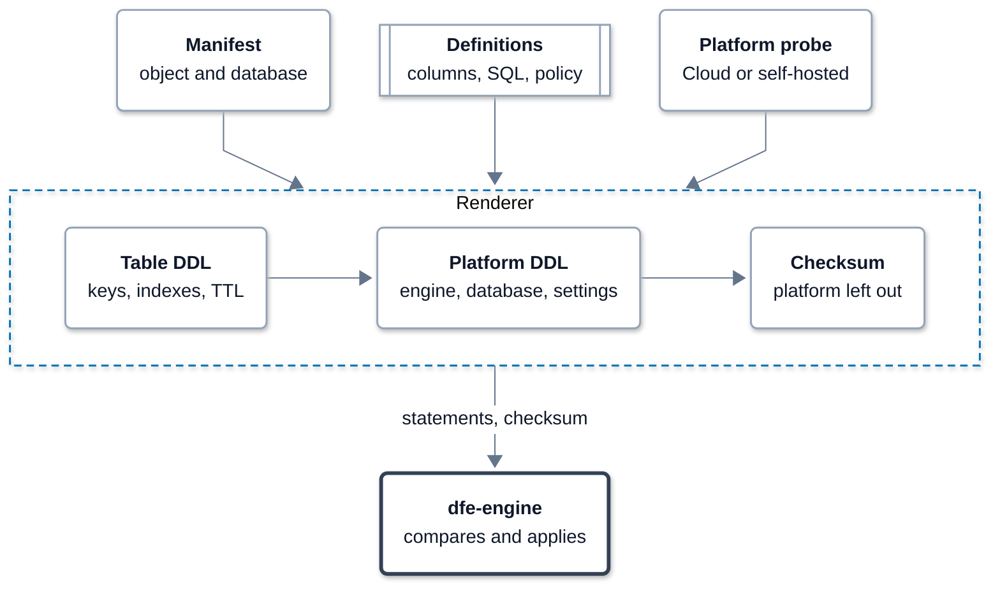

# Renderer

The renderer turns one manifest object into the statements that create it on one ClickHouse platform, and is one part of [dfe-schemas](architecture.md).

| Fact | Value |
|---|---|
| Repo | `hyperi-io/dfe-schemas`, module `dfe_schemas.render` |
| Package | the `dfe-schemas` wheel on PyPI, class `Renderer` |
| Config | the platform, the data database, the default TTL, the broker count and Kafka tiered storage, all passed by dfe-engine |
| Endpoints | none, it is a library |
| Metrics | none. `make render` renders every object for both platforms |

The renderer runs inside dfe-engine and only builds statements. Applying them is the engine's job.

*Figure 1. L4 Detail -- Renderer.* Up: [L3 Components -- dfe-schemas](architecture.md). Down: none.

## How it works

1. **Table DDL** builds the columns, sorting key, skip indexes and TTL. Each index comes from the column's use case in `registries/ddl.yaml`.
2. **Platform DDL** writes the argumentless `Replicated<variant>` engine with no `ON CLUSTER`, through `engine_clause()`. Cloud rewrites it to `SharedMergeTree`, and a self-hosted server without Keeper is rejected rather than given a plain form. The CREATE DATABASE and a JSON table's platform-only settings are written once per platform in `dfe_schemas/sql/platform.sql`, and the **Platform probe** picks the block, once per connection.
3. **Checksum** is a sha256 over the statements with the platform token removed and whitespace collapsed.

A table with an engine that stores no rows is the one exception to step 2. `usage_events` is a `Merge` table over dfe-engine's `all_sources`, so it takes the engine it names.

## Interfaces

| Call | Returns |
|---|---|
| `Renderer(manifest, platform=..., data_database=..., default_ttl_days=..., broker_count=..., kafka_tiered_storage=...)` | A renderer bound to one deployment |
| `render_table(...)` | The statements for one table |
| `checksum(statements)` | The platform-free sha256 dfe-engine records |
| `PlatformProbe` | The platform behind one connection, asked at most once |

The checksum leaves out the database's `ON CLUSTER` and `ENGINE`, a table's `Replicated` prefix and empty argument list, and the platform-only settings. One schema reads as one checksum on Cloud and self-hosted, so the applier's ledger answers "has this object changed" rather than "was it applied somewhere else". A `.sql` view's opening comment block is stripped first, so a reworded comment never reads as a changed view.

## Scaling and failure

A render runs once per object at engine boot, and nothing in it grows with data volume. An object that breaks a check raises rather than render. The checks are listed in [CONTRIBUTING.md Context](../CONTRIBUTING.md#context).

## Related

- [ClickHouse platforms](clickhouse-platform.md): the probe and what a self-hosted server needs
- [Manifest](manifest.md), [Definitions](definitions.md)
